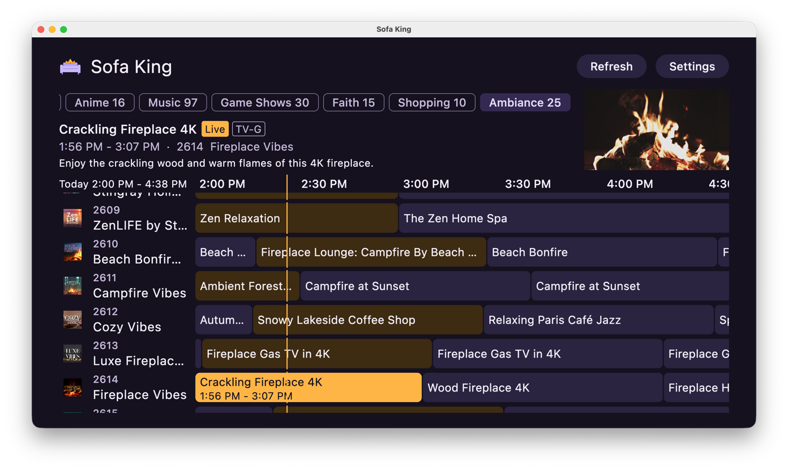
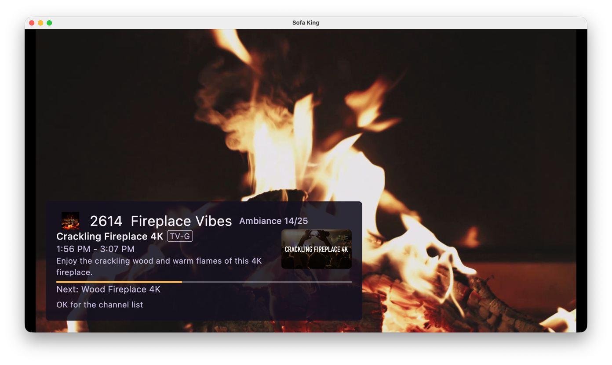

  

<h1 align="center">Sofa King</h1>

<strong>Live TV, Sofa King good.</strong>

  
  
  
  

  

A self-hosted live TV server for a home network, and an app that watches it on Android TV, Google TV, phones, desktops, iOS and the web.

- **One lineup from free TV.** The server merges free streaming services, M3U playlists and XMLTV guides into one numbered lineup, with fallbacks across services.
- **Plays anywhere.** The same lineup goes to the app, to Plex as an HDHomeRun tuner, and to M3U and XMLTV players.
- **Previews that become the show.** The app's guide previews the focused channel muted and opens it full screen on the same stream, with no second tune.

  

## Get it

- **Server:** the image `ghcr.io/jamesarich/sofa-king-backend:main`, published from `main`. [Getting started](backend/docs/getting-started.md) takes a Docker host to a playing channel.
- **App:** the [`snapshot` prerelease](https://github.com/jamesarich/sofa-king/releases/tag/snapshot), built from the latest `main` for Android, Linux, macOS, Windows and the web. [Getting started](app/docs/getting-started.md) installs it and connects it to the server.

The repository, the image and the snapshot are private, so each needs access. Neither part has a versioned release yet. Each README lists what is missing: [server](backend/README.md#limitations), [app](app/README.md#limitations).

| Part | What it is |
| --- | --- |
| [`backend/`](backend/README.md) | The server. Its [documentation](backend/docs/README.md) covers deploying, the lineup and the API |
| [`app/`](app/README.md) | The Kotlin Multiplatform client and its [documentation](app/docs/README.md) |
| [`contract/`](contract/README.md) | The wire types the server and the app share |

The [documentation index](docs/README.md) links every page and the shared glossary. [CONTRIBUTING](CONTRIBUTING.md) covers the conventions both parts share and CI, and [SECURITY](SECURITY.md) covers reporting a vulnerability.

Licensed under the [GNU General Public License v3.0](LICENSE).
