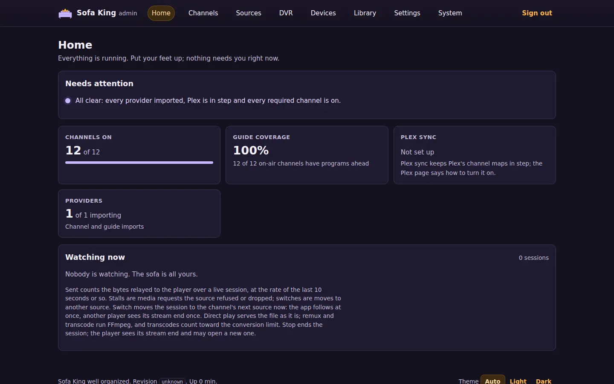
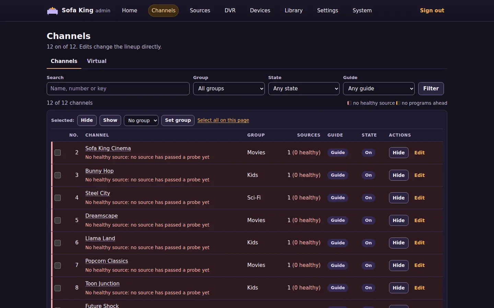
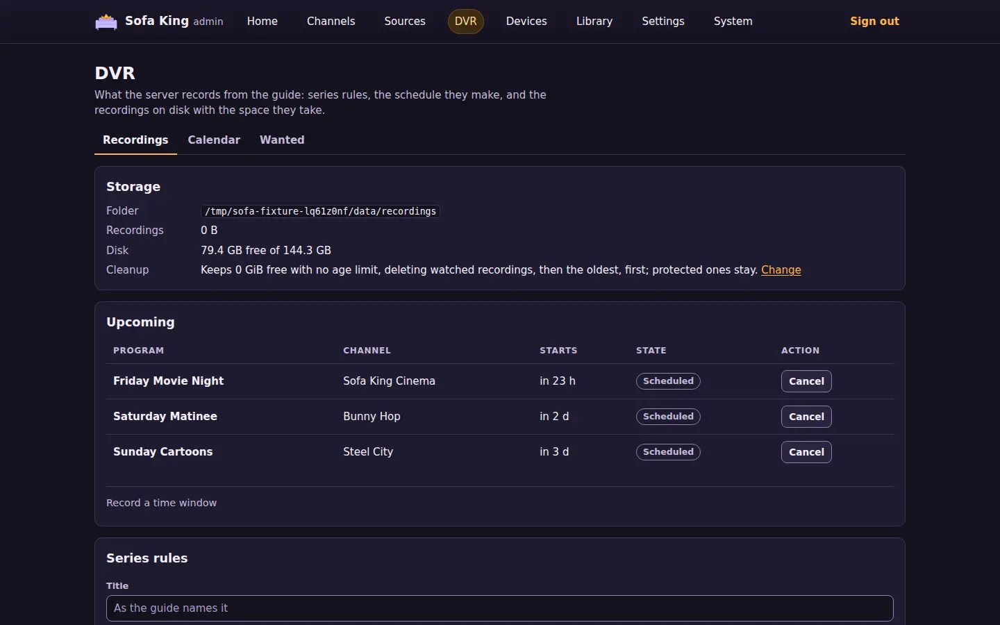
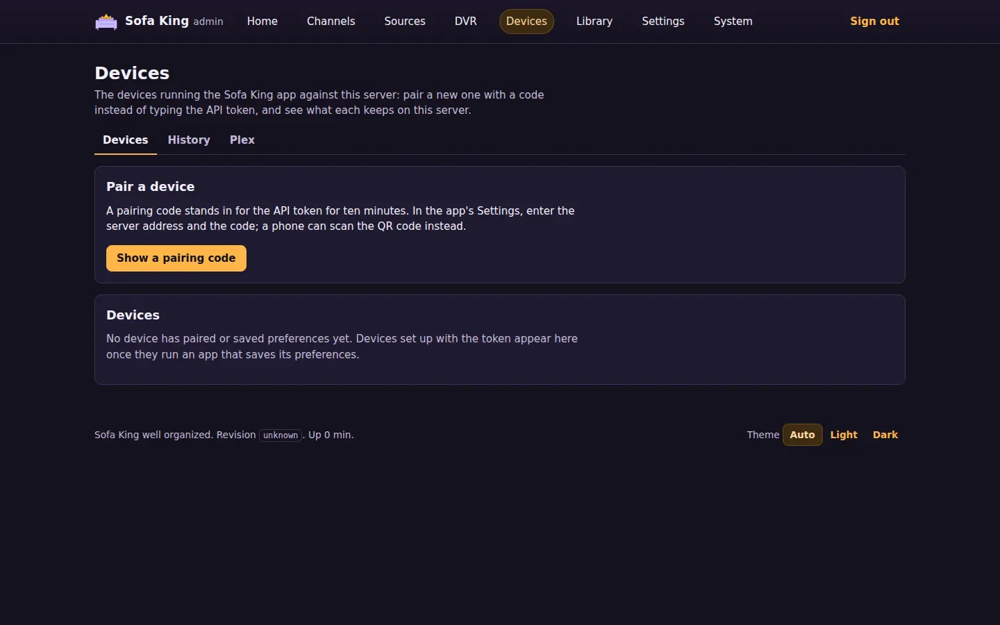
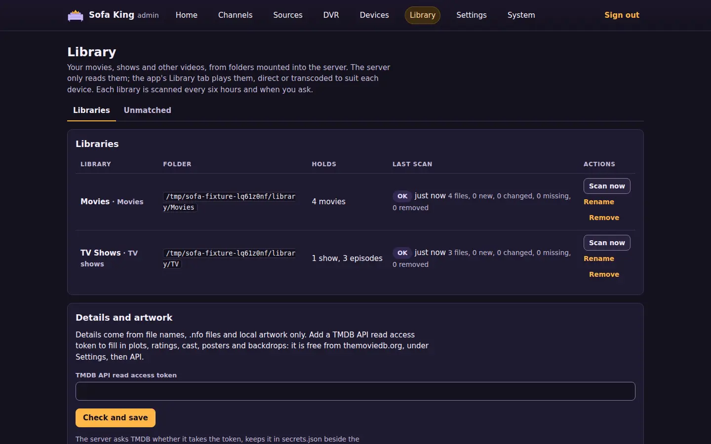
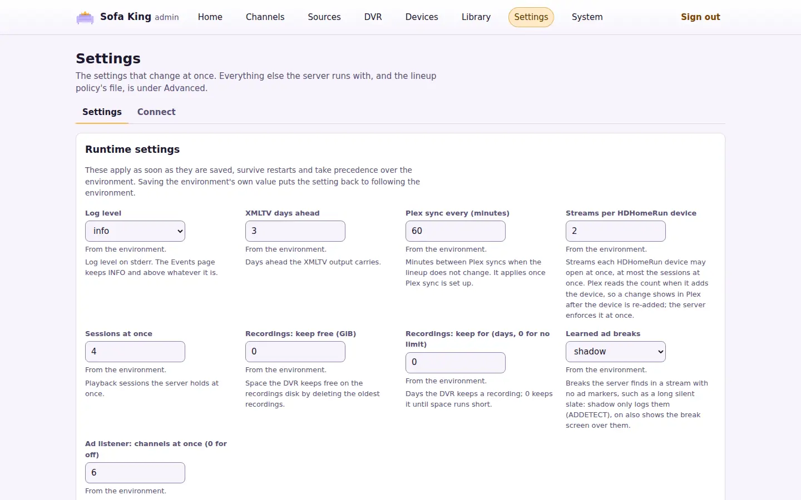

# Admin portal

The server serves an admin portal at `/admin` on its own port. Its server-rendered pages show whether everything is healthy, edit channels, merges, groups and provider priority, and manage recordings, series rules and media libraries. It works from a phone browser and without JavaScript; with JavaScript, [htmx](dependencies.md#vendored-htmx) keeps the page in place after an action.

The portal calls the server's services directly, and apart from the runtime settings edit, a job run on request, stopping a session, ignoring a home page item, canceling a pairing code, backups, the temporary DEBUG level, a TMDB match made by hand, and the update check and request, it changes nothing the [admin API](api.md#admin-api) cannot. It also takes the same paths. Under a [lineup policy](lineup-policy.md), a channel edit is written into the station's override and applied, as `PATCH /api/v1/admin/lineup/{id}` does. A group or provider edit writes the whole policy against the revision the page showed and applies it, as `PUT /api/v1/admin/policy` does.

## Sign in

Open `http://SERVER_HOST:9193/admin` (port 8080 outside Docker) and enter the admin token: `SOFA_ADMIN_TOKEN`, or `SOFA_API_TOKEN` when there is no admin token. A generated one is `adminToken` in `secrets.json` ([read it](getting-started.md#2-sign-in)). On loopback with neither token set, nobody can sign in, and the page says so.

A session lasts 12 hours from sign-in, or until you sign out. Sessions are kept in the database by a hash of their ID, never the ID the cookie holds, so a restart or an update keeps everyone signed in. Up to 32 sessions are kept; a new one replaces the one closest to expiry. Each client address may try to sign in 10 times a minute; beyond that the server answers `429 Too Many Requests` until the minute is up.

## Pages

The navigation has eight destinations: Home, Channels, Sources, DVR, Devices, Library, Settings and System. Channels, Sources, DVR, Devices, Library, Settings and System hold more than one page, shown as tabs under the heading: Channels, Required, Merges, Guide matches, Groups and Virtual; Sources, Ads and iptv-org; Recordings, Calendar and Wanted; Devices, History and Plex; Libraries and Unmatched; Settings and Connect; About, Activity, Changes, Jobs, Backup, Events, Crashes and API. A count beside a destination says how many things there need a look, and the tab that holds them carries the same count. On a phone the navigation folds into a Menu button that carries the total. The footer of every signed-in page shows the server's revision and how long it has been up, and the theme switch: Auto follows the device's light or dark setting, Light and Dark pin one in a cookie.

  
  
  
  
  
  

| Page | What it shows | What it changes |
| --- | --- | --- |
| Home | While the server has no source file, or no policy and no lineup, the setup steps: choose services, build the lineup. Then what needs attention, each with a link to where it is fixed and to the doc that explains it. Then the channels on and their guide coverage, the last Plex sync, required channels on, merges to settle, providers importing (with a policy that waits for verified sources, how many channels still wait and, once probes have run a few minutes, about how long until each has had its sources checked), who is watching (the channel, the program on now, the player and its address, how long it has watched, the bytes sent and the rate, the stalls and source switches, and when its lease ends), what is playing from the libraries and recordings (the title, whether it plays directly, remuxed or transcoded, how long and when its lease ends) and the last lineup run | Ignore an item until it changes, or show it again; switch a session to its channel's next source; stop a session |
| Channels | The lineup, 100 channels a page. Each row has the number, name, group, source count, guide state and state. Search by name, number or station key, filter by group, state, guide state, required, override or changed in the last run, and sort by any column | Hide or show a channel from its row; select channels and hide, show or regroup them together |
| Channel | One channel: its state, why it is off, its station key, guide, and sources in failover order with their provider, protocol and health | Rename, renumber or regroup it, and hide or show it; disable, enable or probe a source |
| Merges | With a policy: the suggested aliases and open findings of a run over the current candidates, the learned aliases and the pairs kept apart | Accept a suggestion, dismiss it, or keep a learned pair apart. Each write applies the policy |
| Guide matches | With a policy: guide channels proposed by name for each station no guide lists, with a confidence, and the prefixes and suffixes ignored ([guide matches](lineup-policy.md#guide-matches)) | Accept a proposal as the station's guide, dismiss it for good, or accept every station's best proposal at `guideMatches.acceptAbove` or more. Each write applies the policy |
| Required | With a policy: the required stations from the last run, off ones first, with their pins, live source count, source health and state | Nothing |
| Groups | With a policy: the number blocks and the groups without one, the default group, the unmapped categories, the category map, the weak categories and the name patterns | Each of those |
| Virtual | The [virtual channels](virtual-channels.md), each with its number, slots and what it airs now; and, while one is being changed, its schedule for the next 12 hours. A note says when the `virtual` source is off or missing from the policy's providers | Add a channel: its name, number, slots (each a library, show or genre, in order or shuffled, with a start time on every slot or none), filler and the mark to fill to; change one, or delete one after a confirmation |
| Sources | Every native service as a switch with the options it takes, the M3U playlists, each provider's channels, last import and status, with the error a failed import ended on, the source file's providers and guides by kind, host and refresh interval (folded, with header and option names but never a value), and each guide's import. With a policy, the provider entries in priority order, with what each takes and the stations each leads | Turn services on or off (and, without a policy, build the starter lineup in the same save), add or remove an M3U playlist, each after a confirmation and followed by a restart; with a policy, reorder, hide, show, add or remove provider entries |
| Ads | What live sessions do with [learned ad breaks](architecture.md#learned-ad-breaks), the background listeners at work, the ads the server has learned with how many it trusts to blank and how many are blocked, and the last day's canary precision. Then each channel a viewer or a listener has played: its provider, the time watched and listened to, the breaks its provider marked, the breaks learned, and when it last marked one and was last watched | Nothing; the two settings are on the Settings page |
| iptv-org | The [iptv-org](lineup-policy.md#iptv-org-metadata) switches, the region in force and whether it comes from the setting or the server's time zone, the last download with its notes and when the next is due, what the files hold, the stations waiting for a match decision, and the stations the iptv-org blocklist holds out, with its reason and reference | Download now; accept or dismiss a station's match, which also lists a held station again. The switches and the region are on the Settings page |
| Recordings (DVR) | The recordings folder with the space its recordings take and the disk's free space, and what cleanup keeps; the upcoming recordings with conflicts marked; the series rules; the recorded and failed ones with their file, size and state. The destination's count is the upcoming conflicts | Add a series rule by title, team or keywords ([match](recordings.md#record-a-series)), edit or delete one; record a channel for a time window; cancel or stop a recording; protect a recording from cleanup or let it go; delete a recording and its file |
| Calendar | The recordings by day in the server's time zone: a week of seven days, or a 30-day agenda that lists only the days with something on them. Each recording shows its times, name, channel and the series rule that scheduled it, edged in its state's color (scheduled, recording, recorded, partial, conflict or failed); today's day is outlined. Earlier, Today and Later move by a week or by the agenda's 30 days. A Subscribe note gives the [calendar feed](recordings.md#subscribe-in-a-calendar) for a calendar app | Switch between week and agenda |
| Wanted | What the DVR meant to record and did not get. Conflicts: the scheduled recordings that lose their slot to others airing at once, soonest first, each with the series rule that scheduled it and its priority. Missed: the recordings that failed in the last 14 days, newest first, each with why in words (the server was down or every slot was taken, the disk filled up, the channel sent nothing, or the source failed) | Put a conflict's rule first: raise its priority above every other rule's so its recordings get the slot |
| Plex | The last Plex sync with each tuner's DVR and mapped channels, each HDHomeRun device with its address and channel count, the devices the lineup needs, Tuner access (the addresses that may use the tuners and the ones refused since the start), the M3U and XMLTV URLs, and the Plex setup steps | Allow an address onto the tuners, from the refused list or typed, and remove one the portal allowed; both apply at once; delete a named output after a confirmation. The output token stays hidden until you choose to reveal it |
| Devices | The devices running the app against this server: each one's name and platform, whether it holds a token of its own, how many channels it hides, its favorites and recent channels, when it last saved them and when it was first and last seen. Above them, pairing: a six-digit code and its QR code while one is live | Show a pairing code, replace or cancel it; open the web app paired with this browser; forget a device, revoking its token, after a confirmation |
| History | Every live channel, library file and recording played here once its session ended, newest first: when it ended, what played, the device (or the player's address), how it played, for how long, the bytes sent to a live player, and why it ended. Filter by kind, device and period; the server keeps `SOFA_HISTORY_DAYS` days ([playback history](api.md#playback-history)) | Nothing |
| Library | Each [media library](libraries.md): its name, contents, folder, what it holds and its last scan. Below them, the folders whose names say what they hold (`Movies`, `TV Shows` and the like) and the form that adds one from any folder under `SOFA_MEDIA_DIR` or `SOFA_RECORDINGS_DIR` | Add a library, from a suggested folder in one click or from the form, which scans it at once; scan one now, rename it, or remove it after a confirmation (its files stay) |
| Unmatched | With a TMDB token: the movies and shows TMDB's search found nothing for, with their library and folder, and the ones matched by hand with the entry they are matched to. Find on TMDB opens a search by title and year, each result linked to its TMDB page ([details from TMDB](libraries.md#details-from-tmdb)) | Choose an entry from the search or by its TMDB id, which every scan then looks up in place of a search; let the scan match an item itself again |
| Settings | The runtime settings and the access tokens. Under Advanced: the lineup policy's file, revision, contents and last run, every startup `SOFA_` variable as the server runs with it, and each token's origin | Save the runtime settings; make read and hook tokens, and revoke one after a confirmation; under Advanced, apply the policy now and reveal the API token |
| Connect | Where the server sends [notifications](notifications.md): each ntfy, Apprise API or webhook target with the events it takes and its last delivery | Add, edit, test and turn off a target; remove one after a confirmation |
| Activity | What the server is doing now, reloading every 15 seconds: Watching now as on Home, the recordings running with how much of their window has passed and their size, and the background jobs running with how long they have run and how far they have come (the shows intro detection has read, the files scrub thumbnails has looked at, the library a scan is on) | Switch a session's source or stop it, as on Home |
| Changes | The lineup policy's change log, newest first: each field a run changed, with the station, before and after, and the cause; the newest 50, or `?limit=` (1 to 1000) | Nothing |
| Jobs | Every background job: each provider and guide import, the lineup policy run, Plex sync, the logo sweep, the recording schedule and cleanup, the library scan, the update check, the daily database backup and the transcode test, which runs only on request, with its interval, last run, duration, result and next due time | Run a job now |
| Backup | The database backups in `backups/` under the data directory, newest first: the daily ones, the ones taken by hand, the database set aside before a restore and the updater's before each update, with when each was taken and its size | Back up now; download a backup; restore a backup or an uploaded database file, after a confirmation, which restarts the server |
| Events | The newest 500 log lines at INFO and above since the server started, newest first, filtered by level and by text. With JavaScript the list refreshes every 10 seconds. Above them, the log file `logs/server.log` and whether DEBUG logging is on, until when | Download the log file; log at DEBUG for 30 minutes, or stop it sooner |
| Crashes | The crashes the apps reported to this server, newest first, with when it arrived, the device, the app and system versions, and the exception with its stack frames behind a disclosure (see [crashes](#crashes)) | Nothing |
| About | Whether the server is up to date: the running and published version and revision, and what the host's updater did last. Then the start time, schema version, JVM, OS, the FFmpeg and Comskip versions, whether FFmpeg has Chromaprint (intro detection and ad matching need it), the GPU devices the container sees, data directory, logging and memory; the Disk panel with each of the data, recordings and media folders, its disk's free and total space and what the recordings take; the [video encoder](libraries.md#hardware-transcoding) in use with the newest transcode test, the status the admin API reports, and a support snapshot to paste into a bug report | Check the registry now; ask the updater to update now; run the transcode test; download the snapshot |
| API | Every HTTP route the server serves, grouped by area, with its token, parameters, body and responses, from the server's OpenAPI document | Download the OpenAPI document |

The home page lists, as needing attention: failed provider or guide imports, a failed Plex sync or tuners missing from Plex, addresses the tuners refused, too few tuners for the lineup, a recordings folder the server cannot write, an app crash reported in the last day, and no import yet once the server has been up for ten minutes. It also lists required channels that are off, merge suggestions, unmapped categories and on-air channels whose guide ended. Each red item says why on one line: a failed import gives its error with any URL removed, and the required channels that are off are named, up to five, each with the reason the policy turned it off. A failing import reads as a check while its last success is under a day old and as broken after that, with how long it has failed; one that has never imported since the server started is broken. Ignore keeps an item off the list, in the database, until its text changes, for instance when another provider fails or the reason changes; the ignored items sit under the list and can be shown again.

On the home page, Stop asks once, then ends the session: the player sees its stream end and may open the channel again. Stop on a library or recording ends it at once and stops its FFmpeg. An M3U or Plex player that keeps requesting media opens a new session at once.

On the Channels page, the state filter offers on and off, and with a policy also unverified. The guide filter offers channels with programs, and channels whose guide is missing or ended. With a policy, "Has an override" keeps the stations whose policy entry holds something set by hand (a number a run wrote back does not count), and "Changed in the last run" keeps the entries the newest run that changed anything touched. A column header sorts by that column; the same header again reverses it. A row is tinted red when the channel is on and none of its sources is healthy, with a line under its name that says why: every source disabled by hand, the providers no longer listing them, the newest probe failure among its sources, or no source passing a probe yet. A row is amber when the channel is on and its guide ended or holds nothing ahead.

The Backup page copies the database while the server runs, with SQLite's `VACUUM INTO` over a connection of its own, so a copy is consistent and compact. The `backup` job takes one a day, ten minutes after the start at the earliest, and keeps the newest seven daily backups; Back up now takes one at once and keeps it until you remove it from the folder. A restore checks that the file is a whole Sofa King database no newer than the running server, stages it as `restore.sqlite` in the data directory and restarts the server. Before it opens the database, the server sets the old one aside in `backups/` as a `before-restore-` backup, with its write-ahead log, and moves the staged file into its place. Everything since the backup was taken is gone, the sessions in it included, so you may have to sign in again. An upload restore takes a file up to 8 GiB.

To chase a problem, use Debug for 30 minutes on the Events page, reproduce the problem, then Download the log. The DEBUG lines go to stderr and the log file, not to the Events page, and the level saved in Settings comes back when the half hour ends or on Stop debug logging. A level finer than DEBUG stays as it is. The download is the current file, the lines since midnight UTC or since it last reached 20 MB; the older files are gzipped beside it in `logs/`.

On the Jobs page, Run now starts an import or a guide import at once, and a policy run or a Plex sync without the usual quiet time. A job's result is its own summary, such as the channels and sources an import found, or the error class when it failed; the Events page has the lines it logged. The Events page keeps its lines in memory, so a restart empties it; the container's log has everything.

## Crashes

An app that crashed keeps the last crash on the device and, on its next start, sends it to this server if its Send crash reports setting is on, which it is by default. The Crashes page lists what arrived: the device's name, the app's version and platform, the system's version, and the exception class, a scrubbed message and the stack frames. The server scrubs a report again on arrival, so no address, token or quoted text is kept, keeps the newest 100, and sends nothing on to anyone. The home page lists a crash received in the last day as needing attention, naming the newest; it clears a day later, and the page keeps the report. The same list is `GET /api/v1/admin/diagnostics/crashes` and the MCP tool `client_crashes`, see [crash reports](api.md#crash-reports).

The About page's support snapshot is JSON with the admin API's status, the server facts, every job's last run and the overview's items. It holds no token, URL or secret. Copy it from the box, or download it with the button.

On the Channel page, the group is picked from the groups the lineup and the policy name. "Policy decides", or "No group" without a policy, removes a group set by hand. With a policy, Gracenote station id sets the id [Channels DVR](live-tv.md#channels-dvr) takes the channel's guide by; an empty field removes it. Each source has Disable, which asks once and then takes the source out of selection as [source health](source-health.md#inspect-or-disable-a-source) describes, Enable, which puts it back at once, and Probe now, which puts the source at the front of the probe queue; the health updates when the probe is done. Probe now is absent when probes are off. Under each source's health are its last three probe results, newest first, each passed or failed with the [failure class](source-health.md#failure-classes) in words, and a suspect or quarantined source says which failure put it there.

On the Channels page, each row has a checkbox, and "Select all on this page" checks the page. Hide, Show and Set group act on the selection: with a policy, one edit writes every selected station's override and applies, after the confirmation the [group and provider edits](#group-and-provider-edits) describe; without one, the edit changes the lineup entries after a confirmation that lists what turns off or on. The selection and the filters survive the edit.

On the Merges page, accepting a suggestion adds it to `names.aliases`, and dismissing it adds the pair to `names.never`. Keeping a learned alias apart adds the pair to `names.never` and drops the alias.

On the Groups page you can add a number block, move its first number or remove it, and set the default group. You can map a category or unmap it, add or remove a weak category, and add or remove a name pattern.

On the Sources page, with a policy, you can move an entry up or down and hide or show the stations an entry leads (its `enabled`). You can add an entry that takes every channel of a provider, or remove an entry.

Without a policy, the Merges, Guide matches, Required and Groups pages explain that they need one, and the Channels section shows the Channels and Virtual tabs only. Channel edits then go to the lineup itself, sending the changed fields the way `PATCH /api/v1/admin/lineup/{id}` does.

After a save the page says what was saved, once, and marks the channel it concerns. A channel edit applies to the policy file as it is when you save, since runs write numbers back to it often. When the policy refuses one, the error shows on the channel's page with the form to correct.

## Devices

Show a pairing code issues a six-digit code that stands in for the API token for ten minutes and one device: on the TV, open the app's Settings, enter the server address the page shows and the code, and choose Pair. The page also draws the code and the address as a QR code; an Android phone, an iPhone or an iPad with the app installed scans it with its camera and pairs at once. One code is live at a time; New code replaces it, Cancel the code drops it, and five wrong attempts void it. The address shown is the one your browser reached the server at, so open the portal the way the TV will reach it.

On a server that [serves the web app](deploy.md#serve-the-web-app), Watch in this browser sits under pairing. Open the web app issues a pairing code and opens the app in a new tab, which claims it and pairs at once; the code rides in the address's fragment, which no request carries, and it replaces any code shown above. Open without pairing opens the app as it is, for a browser that is already paired.

A device appears once it pairs or saves its preferences (its hidden channels, favorites order and recent channels, kept per device so a reinstall or a second device can take them over). A paired device holds a token of its own, and the Token column says so. Forget asks once, then drops what the server keeps for a device and revokes its token, so the device must pair again; a device on the shared API token (set up by hand, or paired before devices had their own) keeps working, and pairing it again gives it its own. The API token never appears on this page; the Settings page reveals it under Advanced.

## Library

Add a library names it, says what it holds (movies, TV shows, other videos or music, which decides how [file names are read](libraries.md#lay-out-the-folders)) and picks its folder from those under `SOFA_MEDIA_DIR` or the recordings folder that no other library uses. The first scan starts at once; later ones run every six hours, Scan now queues one (a Music library's Refresh details queues one that [looks every album and artist up again](libraries.md#details-from-musicbrainz)), and Sonarr and Radarr queue one through the [hooks](integrations.md) when they change a file. A scan that finds the folder missing, or empty while the library held files, reads it as an unmounted disk: the row says Folder unavailable and nothing is changed. Remove asks once, then forgets the library's items and their watch progress; the files are never touched, and adding the folder again brings the items back with the same ids. The Details and artwork panel says whether scans also [look titles up on TMDB](libraries.md#details-from-tmdb), and, unless `SOFA_TMDB_TOKEN` sets the token, takes one: Check and save asks TMDB whether it takes the token, stores it in `secrets.json` and restarts. A token TMDB refuses, or one TMDB cannot be asked about, is not saved, and the panel says why. Once a Music library exists, the Music artwork panel does the same for a fanart.tv key, which adds [artists' pictures and backdrops](libraries.md#artwork-from-fanarttv), unless `SOFA_FANART_KEY` sets it. The Music listening statistics panel does the same for a ListenBrainz user token, which adds [artists' most played songs](libraries.md#listening-statistics-from-listenbrainz), unless `SOFA_LISTENBRAINZ_TOKEN` sets it.

## DVR

A series rule names a title as the guide gives it, a channel or any channel, how many recordings it keeps (0 for all), the minutes it starts early and runs late, its priority when recordings conflict, and whether it takes new episodes only. Edit on a rule changes everything but its title. Record a time window, under Upcoming, records any enabled channel from a start in the server's time zone for a number of minutes, guide or not. Deleting a rule drops its scheduled recordings and keeps what it recorded. Cancel drops one scheduled recording, and a rule does not schedule that airing again; Stop ends a running one and keeps what it recorded. Protect keeps a recording from [cleanup](recordings.md#cleanup). The cleanup line links to the runtime settings that set it.

## Update

The About page starts with the update picture. Running is this server's version and revision, from the image's build. Published is what the registry holds under the image's tag (`SOFA_UPDATE_IMAGE`, `ghcr.io/jamesarich/sofa-king:main` unless set): the server reads the revision and version from the tag's index annotations, two minutes after it starts and every five minutes after, as the `update` job on the Jobs page; Check now runs it at once. When the published revision differs from the running one, the page says an update is available, and if an updater has reported, the server writes `update-requested` for it, as Update now does, so a new build goes in within minutes of being published. It asks once per revision, and never for a revision the updater rolled back or skipped.

Updater is what the host's [updater](deploy.md#update-automatically) reported in `update-status.json` in the data directory: when it last checked and whether it found nothing new, installed an image, rolled one back, skipped one that failed before, or failed. A report over an hour old is marked as not checking in, since the timer runs every 15 minutes. Without a report the page says the updater has not reported and offers no Update now. That means no updater is installed, or the installed copy of `sofa-king-update.sh` is older than the status report: it still swaps images but writes no `update-status.json`. Download the script again and run `install` again; see [update automatically](deploy.md#update-automatically).

Update now asks once, then writes `update-requested` in the data directory. The updater's path unit starts it when the file appears, and the script removes the file as it starts, then pulls, compares and swaps as it does on the timer. The page shows the pending request until the updater takes it. The portal itself never pulls an image or restarts the container; it has no Docker socket.

## Setup

The Sources page edits the source file, so a server needs no hand-written `sources.json`. Every [native service](providers.md) is a switch with what it carries; PBS takes a ZIP code, Local Now a DMA code and market, Samsung TV Plus a region and an HDHomeRun its address, and the other options stay as the file has them. Save asks once, naming the services it turns on or off, then writes the file and restarts the server. The M3U playlists panel lists the file's playlist providers by host and removes one, and adds one from an ID, a playlist URL and an optional guide URL; a token in the URL goes into the file and never onto a page. Every write is checked the way the server checks the file at start, so a refused one changes nothing and says why.

The file goes where the server reads it: the path `SOFA_SOURCES` names, else `sources.json` in the data directory. A `${NAME}` reference in the file stays a reference. Providers, guides and the policy are built from the files at start, so each write ends the process once the page has answered; under the Compose file, `restart: unless-stopped` starts it again within seconds, and elsewhere start it again yourself. The restart keeps everyone signed in, and the page that answers opens the portal again after twenty seconds. Anyone watching loses the stream and can open the channel again.

While the server has no source file, or no lineup policy and an empty lineup, the home page starts with the two setup steps. Choose services opens the Sources page with every service that lists channels without an option already checked. While there is no policy, the services form also has Build the starter lineup too, checked, so one save writes the source file and the starter policy with one restart. Build the lineup, with sources and no policy, asks once and writes the [starter policy](starter-lineup.md): one station per channel, the configured services in the server's priority order (an HDHomeRun tuner first), the shipped group map and number blocks, and `requireVerified`; then the server restarts and runs it. The steps leave the page once both files exist.

## Group and provider edits

A group or provider edit reads the policy file, makes the one change, validates the result and writes it with the revision the page showed, then applies it. Before it saves, the portal builds the lineup from the policy as it is and as the edit leaves it. An edit that changes no station saves at once. One that does waits for confirmation and lists how many channels turn off or on and which change group, number or name.

When the policy changed since the page loaded, the edit is not saved. The confirmation shows what it does against the policy as it is now, and confirming saves it against that revision. When the result would not be a valid policy, every validation error shows in the section the edit came from and nothing is written.

## Settings

The Settings page shows the runtime settings: the log level, how many days ahead the XMLTV guide reaches, the Plex sync interval, the streams each HDHomeRun device may open, the sessions the server holds at once, the free space and days recordings [cleanup](recordings.md#cleanup) keeps, what live sessions do with learned ad breaks (`SOFA_LEARNED_BREAKS`), how many channels the server listens to in the background to learn ads (`SOFA_AD_LISTENERS`), and the [iptv-org](lineup-policy.md#iptv-org-metadata) switches and region (`SOFA_IPTV_ORG`, `SOFA_IPTV_ORG_STREAMS`, `SOFA_IPTV_ORG_REGION`). Save applies them at once, keeps them in the database across restarts, and they take precedence over the environment; the page says beside each which value it follows. Saving the environment's own value puts a setting back to following the environment, as "Back to the environment's values" does for all of them. A value out of range is refused with the form kept; the streams per device cannot exceed the sessions at once. Plex reads a device's tuner count when it adds the device, so a changed count shows in Plex after the device is re-added, while the server enforces it at once. A saved value that no longer fits is dropped at start, with a warning in the log.

Access tokens lists the tokens the server issued: each paired device's, and the read and hook tokens, with when each was made and last used. Make a token takes a label and what it opens: Read for a dashboard such as Homepage, a calendar app or an AI assistant (the [dashboard summary](api.md#dashboard-summary), the [recordings calendar](recordings.md#subscribe-in-a-calendar), the server's status, sessions, guides, lineup and libraries, and the [MCP](operations.md#use-with-an-ai-assistant) read tools) or Hook for Sonarr and Radarr ([setup](integrations.md)). The page shows the new token once; copy it then, as the server keeps only a hash. Revoke asks once, then ends the token. The [API](api.md#tokens) lists what each kind opens.

The Connect tab lists the [notification](notifications.md) targets and adds them: ntfy for a phone, an Apprise API server for Discord, Telegram and the rest, or a webhook such as a Home Assistant automation. Test sends one a notification at once and says whether it arrived.

Advanced, folded by default, holds the lineup policy with Apply now and the startup settings; the policy change log is on System's Changes tab. It opens on its own after an action inside it, and `?advanced=1` opens it. The startup settings mark each `SOFA_` variable that has its default value, and notes the source and policy files when they were found in the data directory.

It reports each token as generated (stored in `secrets.json`), saved from the portal (the TMDB token, also in `secrets.json`), set (in the environment or through its `_FILE` variable) or not set. It shows no token until you choose "Reveal the API token", which shows the API token the Sofa King app needs. The Sources page describes the source file by provider, kind, host and refresh interval, with header and option names. It never shows a URL path or query, a header value or an option value.

Device addresses on the Plex page use the host the page was reached by; extra devices use their own ports from `SOFA_HDHR_EXTRA_PORTS`.

Named outputs on the Plex page lists each [named output](live-tv.md#named-outputs) with its playlist and guide URLs, the token hidden as in Player outputs, and a Delete for each, which asks once. Save output takes a name, comma-separated groups and comma-separated channel numbers or IDs; a name that exists is replaced.

## Security

The session cookie, CSRF token, content security policy and token handling are in [security](security.md#credentials-and-the-routes-they-open). The portal is meant for the LAN: reach it through a TLS-terminating proxy if the token crosses a network you do not control. The output token appears only on the page answering "Reveal the output token", and the API token only on the one answering "Reveal the API token"; no other token reaches any page. The theme cookie, `sofa_theme`, holds only `light` or `dark`, scoped to `Path=/admin` for a year. The docs links on the home page point at this repository on GitHub.
