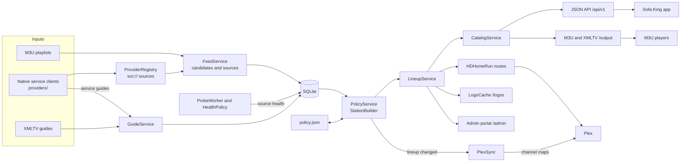
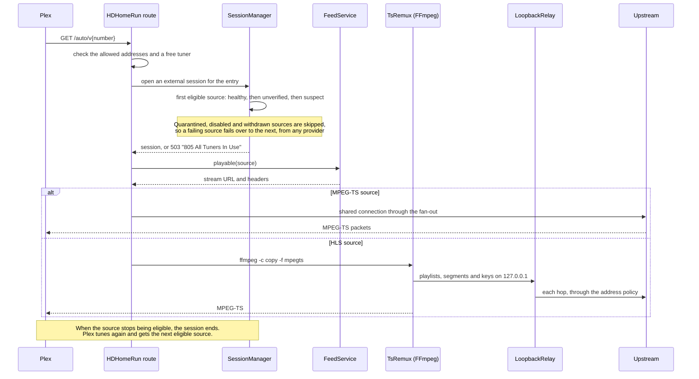

# Architecture

One Kotlin/JVM process serves the HTTP API, the admin portal, the media relay, the DVR and the media libraries. SQLite stores provider snapshots, detected source protocols, the lineup, guide channels and programs, the server identity and source health. It also holds probe attempt times, observation history, the logo cache index, native provider state (device IDs, tokens), the lineup policy's station availability and change log, the paired viewers and their preferences, the runtime settings saved in the portal, its signed-in sessions (by the hash of their ID) and the home page items it ignores, the recordings, their commercial breaks and the series rules, and the media libraries, their items, TMDB details and watch progress. The logo files sit beside the database in the data directory, the recordings in the recordings folder. Playback sessions, library playback sessions, the live pairing code and resolved native stream URLs exist in memory.

The terms used here (provider, source, candidate, station) are defined in the [glossary](README.md#glossary), and lineup entry in the [repository glossary](../../docs/README.md#glossary). In code, a source is an `Offering`.

## Modules

| Module | Contents |
| --- | --- |
| `../contract` | The live TV, recording and library request and response types the server shares with the app, a Kotlin Multiplatform build included from `settings.gradle.kts` |
| `server` | The admin, lineup policy and status models, Ktor Netty server, imports, SQLite storage, lineup, source probes, media relay, player outputs, HDHomeRun emulation, media library scans and admin portal, JVM 21 |

## Data flow

Providers and guides are imported into SQLite. The lineup policy turns the imported candidates into stations, and the lineup serves them to every client.

Every playback path ends in a session. `SessionManager` picks the entry's first eligible source, and `FeedService.playable` resolves a native `svc://` source to its stream URL. `MediaRelay` serves HLS and shared MPEG-TS, and `TsRemux` turns HLS into MPEG-TS for Plex, reading it through `LoopbackRelay`. This is how Plex tunes a channel:

Provider imports publish complete snapshots, and an invalid import keeps the previous snapshot. An import whose channels and sources equal the stored ones writes and publishes nothing and triggers no run, except the first success after a start. Guide imports replace one guide's rows as a new generation: the rows go in over several short transactions beside the current ones, one small transaction makes them current, and the old generation is then deleted in steps, so readers see the old guide or the new one and other writes interleave with a large import. They keep programs only for channels the lineup maps onto that guide and, with a policy, the guide candidates of stations whose guide has nothing ahead; the channel index is kept whole. Immutable in-memory indexes serve catalog requests, and guide programs are read from SQLite by guide, channel and window. SQLite uses WAL, foreign keys, bounded blocking transactions, and versioned atomic migrations whose versions may have gaps. Writes run in order on one connection and its thread; reads that need nothing from a write run on a second, read-only connection, which sees the last commit, so a long write never holds up a guide or library read. A transaction that holds its connection for over 500 ms is logged as `slow database transaction` with the file it came from. Source health and native provider state are kept in memory and written through, so tuning reads neither.

A source's protocol is the one detected in its stream body, by the probe's HTTP tier or by a media fetch. It is stored per source ID and applied over every published snapshot. Until a detection exists, the import's protocol applies: the entry's `stream-type`, else the provider's `defaultProtocol`, else the path extension.

## Guide imports

`GuideService` parses each guide as a stream. It keeps the `<channel>` index, and every channel ID seen on a program, for guide mapping, and it keeps programs only for the channels named above (see [lineup](#lineup) for the refresh a new mapping triggers). The download follows up to five redirects and is bounded by a 15-second socket inactivity timeout rather than a total request timeout. It is read as gzip whenever the body starts with the gzip magic bytes, whatever the content type says, and the decompressed size limit counts bytes as they stream past the parser.

A `<!DOCTYPE tv SYSTEM "xmltv.dtd">` declaration is accepted. The DTD is never fetched, and an entity declared in the document fails the import instead of resolving. In UTF-8 and single-byte guides, control characters that XML forbids are dropped before parsing and counted as `controlChars` in the import log line. A UTF-16 guide is parsed as sent. Each guide fails on its own: the failing one reports `IMPORT_FAILED`, the others keep refreshing, and the log line carries the exception class and its message with URLs redacted.

## Native providers

`providers/` holds one `ProviderClient` per service behind `ProviderRegistry`, which `FeedService` and `GuideService` call for `type: native` providers. A client lists `ProviderChannel`s: the service's own IDs, numbers, logos, group and region tags. It can serve the service's guide as a `ParsedGuide` for the channel IDs the lineup wants, and it resolves a channel ID to a `ResolvedStream` (URL, headers, expiry).

The registry derives channel and source IDs the way `FeedParser` does, with `svc://service/id` as the source URL. Identities are deterministic, and the lineup, health and outputs see ordinary HLS sources. `FeedService.playable(offering)` is the one seam. A native source resolves through the registry: cached per source, single-flight, dropped a minute before expiry and kept at most six hours. Any other source returns its own URL and provider headers. `MediaRelay`, `ProbeWorker` and the HDHomeRun remux fetch what `playable` returns. The relay substitutes the resolved URL for the session's root resource only, since child playlists and segments are absolute by the time the player asks for them.

A `ProviderFailure` is transient (provider evidence, `502` to a session) or not (the channel is gone, evidence against the source). `ProviderContext` gives each client its options and HTTP through the upstream address policy, with hand-followed redirects that keep `Authorization` and `Cookie` on the requested origin, gzip detection and the cookies a response sets. It also gives a short-lived shared cache for the service's payload and durable state in `provider_state`: one random device ID per provider per install, and session tokens with expiry.

## Identity

The app's channel ID is the lineup entry UUID. Under a lineup policy it is the station override's `id` or one derived from the station key; otherwise it is the `id` an entry was created with, or a random UUID. Entries persist independently of providers: a withdrawn source leaves the entry in place and is skipped for playback.

Candidate IDs use published `channel-uuid` values. Otherwise they are UUIDs derived from the provider ID and the exact `channel-id` or `tvg-id`, or else from the provider ID and the source key. The source key is the URL's lowercase scheme and authority, its percent-decoded path and its remaining query parameters sorted, after the provider's renewable parameters are dropped (`SourceIdentity.kt`; the default list and the `renewableQuery` override are in [live TV](live-tv.md#source-identity)). Source IDs use explicit `stream-id` values when supplied, and otherwise derive from provider, channel key and source key. A rotated token changes neither ID, and two URLs that differ only by a renewable parameter are one source.

Guide programs belong to a guide ID and XMLTV channel ID. A program's metadata beyond title and description (sub-title, episode numbers, icon, categories, rating, new and repeat flags, date, language) is stored as one compact JSON column, null when the source gave none. An entry's `legacyGuideId` is its mapped XMLTV channel ID. Program IDs in the API derive from the entry ID, times and title.

## Lineup

`LineupService` keeps the entries in memory and writes the whole lineup in one transaction on each change, under a mutex. Each entry carries its ordered source IDs and optional guide mapping. When a change maps channels a guide did not retain before, the guide's loop is asked to refresh, and repeated requests before it runs coalesce. `CatalogService` resolves entries against current sources, health and guide coverage. Disabled entries are not served. A guide query answers a disabled or unknown entry with a `ChannelGuide` row of status `removed` and no programs, and playback answers it `404 CHANNEL_NOT_FOUND`.

## Lineup policy

With a lineup policy (`SOFA_POLICY`, or `policy.json` in the data directory), `PolicyService` builds the lineup; without one, only the admin API changes the lineup. `StationBuilder` is pure. It turns one snapshot of candidates, guide listings, health and the remembered `station_availability` rows into stations, findings and the numbers it assigned.

`apply` writes the stations through `LineupService.mutate` only when they differ, replaces the availability rows, and logs field changes to `policy_change` (the newest 10,000 are kept). It then writes assigned numbers into the file. `PolicyFile` serializes every write behind one mutex and checks the on-disk SHA-256 against the loaded revision. It writes a temporary file, syncs it to disk and renames it. The loop runs on provider import, guide import and health triggers after a quiet period, and every 900 seconds. [Lineup policy](lineup-policy.md) describes the file and the run.

## Plex sync

With `SOFA_PLEX_URL` set, `PlexSync` keeps Plex's channel maps for this server's HDHomeRun devices in step with the lineup. The start and every policy apply that changed the lineup request a sync, which runs after a 120-second quiet period, and the loop also runs every `SOFA_PLEX_SYNC_MINUTES`. It shares the runtime's HTTP client, sends the token only as the `X-Plex-Token` header and follows no redirects. Each sync's status is stored in the database, and a start reloads the last one, which the API and the portal show until the next sync replaces it. The DeviceIDs come from the same `hdhrDeviceId` the HDHomeRun routes report. [Keep Plex in step](live-tv.md#keep-plex-in-step) describes what a sync does.

## Playback

Sessions select from the entry's sources in the [selection order](source-health.md#source-selection). They have preview or watch intent (45-second and 90-second leases), idempotency keys and stream epochs. `SessionManager.makeRoom` frees a slot at capacity: it evicts the oldest preview session, else the external session with no request in flight that expires first, and otherwise refuses with `429 CAPACITY_EXHAUSTED`. Release, expiry, eviction and source disable cancel active media requests.

The HLS relay rewrites variant, audio, subtitle, key, initialization-map and segment URLs into opaque session paths. It preserves playlist tags and byte ranges. It forwards the LL-HLS delivery directives `_HLS_msn`, `_HLS_part` and `_HLS_skip` from a playlist request to the upstream playlist. Token lookups are O(1) in both directions. Root and playlist tokens are pinned for the session's epoch, and segments and keys share a 4,096-entry LRU. Limits are 12 active requests per session and 32 concurrent upstream connections across the server. Upstream addresses follow the [address policy](live-tv.md#upstream-addresses); a refused address answers `502 UPSTREAM_REJECTED`.

Pluto now and then answers a live media playlist with no segments and `#EXT-X-ENDLIST`, which would end the stream for every player. The session's `SteadyPlaylists` sends the last playlist from that URL that held segments in its place, and the player's next refresh catches up. After such a lapse Pluto can start its numbering over, lower than what the player holds, and a player waits for numbers past its own, so it would stall for good. `SteadyPlaylists` numbers a restarted window on from where the last one ended, with an `#EXT-X-DISCONTINUITY` before its first segment and `#EXT-X-DISCONTINUITY-SEQUENCE` kept counting; a lower-numbered window whose segments were all sent already is a stale copy, and the last playlist goes out instead.

On the app's own sessions, `AdBreaks` also marks the ads in each live media playlist before the relay rewrites it: it appends one `#EXT-X-SOFA-AD:FIRST=<msn>,LAST=<msn>[,ENDS=<seconds>]` line (the contract's `AdRun`) for each run of ad segments, with `ENDS` when the stream planned the break's length. It reads SCTE-35 cue tags (`#EXT-X-CUE-OUT`, `-CUE-OUT-CONT`, `-CUE-IN`, as Tubi, Whale and LG send them), `#EXT-X-DATERANGE` with `SCTE35-OUT` in a dated playlist, Pluto's stitched ads, which are the segments its ad muxer serves under `/v1/mp4/` or `/mp4/v1/`, creatives served straight from its ad store (`/<n>_ad/creative/`) and its bumper clips, and the ads AWS MediaTailor stitches for Xumo and Plex, which it serves through its segment route (`/v1/segment/<hash>/<configuration>/<session>/…`, or `/segment/…` behind Xumo's CDN) while the show stays on its origin, and the ads and promos Roku stitches from its ad servers (`osm-ads*.delivery.roku.com`, and `/osbt/…` on `osm-<region>.sr.roku.com`) while its channels play from `gcp-live-*.delivery.roku.com`, the ads Ottera stitches from `stream.ads.ottera.tv`, Google's ad pods on `dai.google.com/linear/pods/`, and the segments Wurl's own stitcher titles `tag=ad` in `#EXTINF` (`tag=content` otherwise; its picture-in-picture `#EXT-X-TRANSMIT-CUE-OUT` overlays are not breaks). It also reads the flags two origins write into their segment URLs: Amagi's ad insertion serves segments through a `/beacon/` URL on `*.amagi.tv` whose `media_type=M` marks an ad (Whale's and Plex's Amagi channels; once a player fetches them it keeps a beacon only on every third segment of a break and serves the rest plainly from the playout, so a plain playout segment counts as the beacon before it; on Plex a single part between two such ads joins the break, as with MediaTailor, Ottera, Google's pods and Wurl), and the fuelmedia.io origin behind some Stirr stations names its decorated segments `/play/seg/<variant>/<token>.ts`, where the token is base64url gzip JSON whose `SegTag` sets `IsAdBreak`, `IsAd` or `IsAdFiller` in a break. A discontinuity alone is not a break. Whale and LG send one `#EXT-X-CUE-OUT:<seconds>` before a break and nothing on the segments after it, so `AdClock` keeps a cue open across refreshes until `#EXT-X-CUE-IN`, its planned end, or 4 minutes without either. Many playouts (Amagi's, Samsung TV Plus, Whale and LG) keep the broadcast's SCTE-35 cues inside the segments, on a PMT stream of type 0x86, while their playlists say nothing; as the relay passes a transport stream segment to the player, `SpliceReader` reads its `splice_insert` cues, and `time_signal` cues whose segmentation descriptor starts or ends a break, ad or placement opportunity. `AdClock` places each break on the playlist's timeline at its splice time, counted from the segment's first frame, for the length the cue gave, until a cue returning to the network or 4 minutes without either, and marks the segments it covers from the next refresh on. Third-party players and FFmpeg get the playlists unmarked; a player that does not know the tag ignores it. The Android app reads the marks for its break screen. AVPlayer, libVLC and a browser's video element cannot read playlist tags, so the session's `AdClock` keeps each playlist's segments on a timeline of its own and notes the last segment the player finished fetching; `GET /api/v1/playback-sessions/{id}/ad-break?aheadMs=` counts the player's loaded-ahead time back from that segment's end to find the segment on screen, and answers whether it is an ad and how long the break has left.

## Learned ad breaks

A playlist that has carried no marker may still have breaks the server learns from the stream itself, under `SOFA_LEARNED_BREAKS` (`shadow` by default: each is logged as `ADDETECT` and none is marked; only `on` marks one for the player). The relay keeps each transport stream segment it passed to the player and, once it is answered, the session's `AudioFollower` has `SegmentAudio` pipe it through FFmpeg for its first audio track as 11,025 Hz mono, two segments at a time server-wide. A playlist's audio is read as one stream from segment to segment, so its [Chromaprint](https://acoustid.org/chromaprint) points (one every 124 ms) fall on one grid wherever a segment starts. The first marker a playlist carries ends the learning on it, since markers are exact.

`AdClock` joins the silent stretches (below -60 dBFS, read every 100 ms) across the segments of the playlist's timeline: 20 seconds or more is a silent slate, the filler some playouts air when a break goes unsold, which covers the segments its silence covers (`rule=slate`); 10 to 20 seconds is only reported (`slate-short`).

`BreakLibrary` keeps the ads the server has heard. Each break a provider's markers opened and closed is learned as its points from 3 seconds in from each edge, at least 10 seconds and at most 4 minutes of them, kept in memory and saved to the `ad_break` table every 5 minutes. An ad not heard for 30 days goes, and past 2 million points (about 69 hours) the least recently heard go first. On a playlist that marks nothing, the newest 20 seconds are looked up in it: points that agree exactly vote for an ad and an offset into it, and the best few are checked point by point, at most 6 of 32 bits apart, over a run that reaches the newest audio. The break then follows the ad until it stops matching, 4 minutes at most, and covers the segments whose middle it covers (`rule=library`). An ad blanks only once it has been heard on two channels or on two days. On a marked playlist the library is checked against the markers as a canary: a match inside a marked break is a hit, and one in content more than 5 seconds from any break is a false hit, which blocks that ad. Below 99.9% of hits over the last day, no learned ad blanks until the share recovers.

When a session ends, its `ADCENSUS` log line gives the channel's time played, whether it was marked, and the marked and learned breaks, and the `ad_channel` table adds them up per channel for the portal's Ads page.

`AdListener` plays up to `SOFA_AD_LISTENERS` channels (6 by default) in the background, 20 minutes each, through an `AdClock` of its own that is always in shadow, so the library learns from the channels that mark and is tried on the ones that do not while nobody watches. It starts 5 minutes after the server and picks first the channels watched in the last 14 days that have never marked a break, the most recently watched first, then the other channels watched in that time, then channels it has never heard, then the ones it heard longest ago. It never takes a channel someone is watching and ends a turn when someone starts. It reads the lowest variant of an HLS playlist, or that variant's audio rendition, and skips Pluto (whose ads are stitched for each session and always marked), encrypted or fMP4 playlists, and for an hour a provider that answered 403 or 429. Its time is counted as listened, apart from the time viewers watched.

## Player outputs

`/output/playlist.m3u` and `/output/guide.xml` are rendered from the catalog and the stored programs on each request; nothing is cached or stored for them. `/output/stream/{id}` opens an external session: a watch session with no idempotency key whose lease is the player's activity. `SessionManager.acquire` and `finished` move its expiry 60 seconds past each media request. A request still in flight exempts it from reaping, and the request handler releases it when a TS response ends. Capacity eviction treats it as described under [playback](#playback).

An HLS source is answered with a redirect to the session's root playlist, so one session serves every player on that channel. An MPEG-TS source is served through the same fan-out as an API session. The handler catches the relay's protocol-mismatch `410` and switches paths within the request.

## Logos

`LogoCache` keys each lineup logo by the SHA-256 of its source URL. It keeps an in-memory index of the `logo_cache` rows, which name the stored content type, size, content hash, last fetch and last failure. Files live at `SOFA_DATA_DIR/logos/<key>`, written to a temporary name and moved into place. The client-facing behavior is in [API logos](api.md#logos).

Logo references are normalized when a playlist, guide or import is read: whitespace is trimmed, unencoded characters are percent-encoded, and a relative path resolves against the playlist or guide URL. A reference that is not an HTTP(S) URL after that counts as no logo. A fetch normalizes a stored URL the same way.

A fetch goes through `withUpstreamResponse` with the [upstream address policy](live-tv.md#upstream-addresses) and no provider headers. It must answer `200` with a `Content-Type` of `image/png`, `image/jpeg`, `image/webp`, `image/gif` or `image/svg+xml`. It caps the body at 2 MiB, by `Content-Length` first and then during the read. It types the body by its signature, so a mislabeled PNG is stored as PNG and a declared SVG must be XML; anything else is a failure row. A PNG or JPEG wider or taller than 512 pixels is stored scaled down to fit 512 by 512, keeping its proportions and a PNG's transparency. A smaller one, a GIF or WebP, and one that would not get smaller are stored as fetched. An SVG is stored and served byte for byte. Fetches are single-flight per key and share a semaphore of four.

`FeedService` and `LineupService` signal a conflated trigger after each import or change. The sweep loop in the runtime scope then fetches every wanted key that is missing, or a week old and not failed within the hour. It deletes the rows and files of logos the lineup does not name. A request for a key with no usable file fetches it inline when the lineup names it. The catalog route sends a channel's logo as the server-relative path `/logos/<key>`, which a client resolves against the base URL it uses, so the channels ETag covers only the catalog revision; the output routes write the absolute `BASE/logos/<key>` from the request `Host`.

## HDHomeRun emulation

`HdhrRoutes` renders the discovery, lineup and status documents from the lineup on each request. The device ID is configured or derived from the server identity, so it survives restarts. Each extra port is one more device, with a `DeviceID` derived from the first device's and a UPnP `UDN` derived from the server identity, each with the device's position. `/auto/v{number}` opens an external session per request, never shared, counted against `SOFA_HDHR_TUNERS` separately from the session cap. An MPEG-TS source reuses `MediaRelay`.

An HLS source goes to `TsRemux`, which runs one FFmpeg per response reading the source through the [loopback relay](#ffmpegs-reads). The address policy is checked first. The command is `ffmpeg -hide_banner -loglevel warning -nostdin -rw_timeout 15000000 -protocol_whitelist http,tcp,crypto -headers 'X-Sofa-Relay: CREDENTIAL' -i RELAY_URL -sn -dn -c copy -f mpegts -mpegts_flags +resend_headers -flush_packets 1 pipe:1`. Its own stream selection takes one video stream (the highest resolution) and one audio stream (the most channels), so the other variants are not downloaded, and `-sn -dn` drop subtitle and data tracks, which have no reliable MPEG-TS mapping. The handler copies the pipe into the response. The request's job is attached to the session so it counts as in flight. A watchdog coroutine kills the process when the response is canceled, because a blocked pipe read does not notice cancellation. The process is always destroyed and waited for before the handler returns, and `LiveRuntime.close` kills every remux. The allow-list (`AddressAllowList`) matches IP literals and CIDR blocks against the connection's remote address, and compares IPv4-mapped IPv6 addresses as IPv4.

## Live MPEG-TS relay

Sessions playing the same MPEG-TS source share one upstream connection. The relay forwards whole 188-byte packets unchanged, so captions and other in-band data pass through. Each session reads through its own bounded buffer of 128 chunks. A session that falls behind is disconnected while the upstream and the other sessions continue. A new media request from a session replaces its previous MPEG-TS request.

When the upstream ends or fails, the relay reconnects with backoff from 0.5 to 8 seconds, for a 30-second grace period measured from the last received packet. Throughout any gap of more than a second it writes MPEG-TS null packets (PID 0x1FFF) to every session about once per second, so an 8-second player read timeout never fires. Sessions end only when the grace period expires. The upstream socket has a 15-second inactivity timeout, which counts as a failure and starts the grace period. An upstream with no sessions closes after two seconds.

## FFmpeg's reads

`LoopbackRelay` is the relay FFmpeg reads every source through: the HDHomeRun remux, the recorder and the probes' decode tier. It listens on `127.0.0.1` on a port the system picks, started with the first FFmpeg run, apart from the public server, so its one route, `/relay/{lease}/{token}`, is no part of the API and nothing off the machine reaches it. Each FFmpeg run holds a lease: a random lease ID, a token for the source URL and a random 256-bit credential, which FFmpeg sends as the `X-Sofa-Relay` header (its HLS demuxer passes `-headers` on to every playlist, segment and key request). An unknown lease or a wrong credential answers `401`, and the lease ends when its FFmpeg does. The credential is only in FFmpeg's arguments, which are never logged.

A lease's requests are served by the code that serves a session's media requests: the resource is fetched under the [address policy](live-tv.md#upstream-addresses) with redirects followed and checked by hand and the provider headers scoped to their origin, a playlist is rewritten so its URIs become the lease's paths, and the bytes are streamed back. The requests share the relay's cap of 32 upstream connections. An upstream status other than `200` or `206` reaches FFmpeg as that status, so the probe's failure classes read it as they would from the upstream, and a refused hop answers `422`. FFmpeg is started with `-protocol_whitelist http,tcp,crypto` and without `http_proxy` in its environment, so it reaches nothing but the relay. Each request costs one loopback hop and one pass of its bytes through the server, the same as a player's request to `MediaRelay`.

## Media libraries

`LibraryService` keeps the libraries in SQLite (`library`, `library_item`, `play_state`) and runs one scan at a time on its loop. `LibraryScanner` walks a library's folder without following links, skipping hidden and extras folders, and builds movies, shows with their seasons and episodes, or videos from the [file names](libraries.md#lay-out-the-folders), `.nfo` sidecars and local artwork. FFprobe reads new or changed files, two at a time, with a 30-second limit each. Item ids are name-based UUIDs of the library id and the relative path. A missing file is marked and deleted after seven days; an absent or emptied folder changes nothing, since that is what an unmounted disk looks like.

## Recordings

`dvr/Dvr` keeps the series rules and recordings in SQLite and runs two loops. The scheduler (`DvrPlanner`) reads the guide's airings of the rules' titles after every guide import, rule change and every 30 minutes, adds the ones no recording holds yet by channel and start or by episode, and drops rule airings the guide no longer has. The recorder loop looks every five seconds for recordings whose padded window has opened and starts a `Recorder` for each. A `Recorder` opens an external playback session for the channel, which a request job holds busy, resolves the session's source, and appends its MPEG-TS to the file until the window closes: an MPEG-TS source's shared connection as it is, anything else stream-copied by FFmpeg through the [loopback relay](#ffmpegs-reads); a source that ends is reopened through a new session, so failover follows source health. `RecordingLayout` names the file, which is written under `.inprogress/` and moved into place at the end. After each recording and with every scheduler pass, `Dvr.cull` deletes what the rules' keep counts, the keep days and the free-space floor no longer keep. `Commercials` runs Comskip on each finished recording, one at a time, and keeps the breaks and an EDL beside the file. See [recordings](recordings.md).

## Supported scope

The server supports configured HTTP(S) playlists and guides, native provider clients, the lineup policy, JSON control and admin requests, and the admin portal. It supports HLS and MPEG-TS passthrough, M3U and XMLTV output with per-channel stream URLs for third-party players, and cached lineup logos served from this server. It supports HDHomeRun emulation with an HLS-to-MPEG-TS stream-copy remux for Plex, Plex channel-map sync, and FFmpeg source qualification. It records channels into MPEG-TS files and plays recordings and library items as they are or as HLS that FFmpeg copies or converts. It advertises itself over mDNS for the app. Timeshift and transcoding of live channels, shared HLS upstreams, SSDP and HDHomeRun discovery, and events are not implemented. HLS variable substitution and content steering are unsupported.

## Operations

Health observation history is pruned to `SOFA_OBSERVATION_RETENTION_DAYS` (default 7) at the start of each probe batch. Source health, strikes and probe attempt times are separate rows and are never pruned.

The channels `ETag` is a hash of `CatalogService.catalogRevision()`, which derives from the lineup, the published channels and sources, each guide's import time, the health table's row count and latest update, and which entries' guides are still current. Logos in the body are server-relative, so the request's `Host` does not enter it. A matching `If-None-Match` is answered without building the body.

Logback is configured from `SOFA_LOG_LEVEL` and `SOFA_LOG_FORMAT` before the first logger is used, with one appender on stderr: a text pattern that ends with the MDC, or logback's JSON encoder. Ktor's `CallId` gives every request a 16-hex-digit ID, put in the MDC as `requestId` and returned as `X-Request-Id`. `CallLogging` writes the access lines. [Logs](operations.md#logs) describes what the server logs and what it never does.

On SIGTERM Ktor's shutdown hook stops the HTTP server; once it has stopped, the runtime (imports, probes, relay upstreams and sessions) closes and then the store, in that order, and each step is logged.

[API usage](api.md) and [source-health behavior](source-health.md) describe the server interface.
