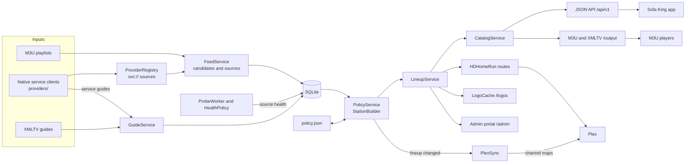
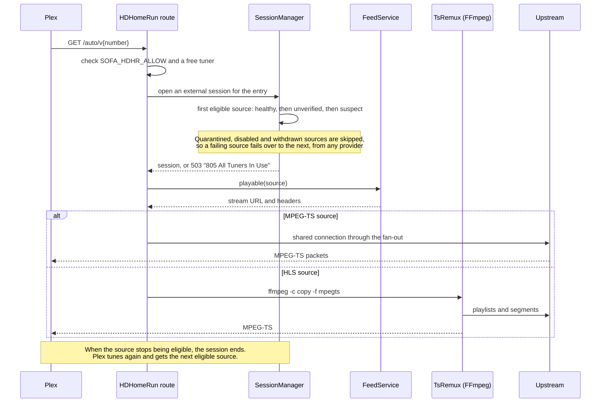

# Architecture

One Kotlin/JVM process serves the HTTP API, the admin portal and the media relay. SQLite stores provider snapshots, detected source protocols, the lineup, guide channels and programs, the server identity and source health. It also holds probe attempt times, observation history, the logo cache index, native provider state (device IDs, tokens), and the lineup policy's station availability and change log. The logo files sit beside the database in the data directory. Playback sessions and resolved native stream URLs exist in memory.

The terms used here (provider, source, candidate, station, lineup entry) are defined in the [glossary](README.md#glossary). In code, a source is an `Offering`.

## Modules

| Module | Contents |
| --- | --- |
| `api-contract` | Serializable request/response models, including the admin and lineup policy models, JVM 17 |
| `client` | Ktor client and playback lease handles, JVM 17 |
| `server` | Ktor Netty server, imports, SQLite storage, lineup, source probes, media relay, player outputs, HDHomeRun emulation and admin portal, JVM 21 |

## Data flow

Providers and guides are imported into SQLite. The lineup policy turns the imported candidates into stations, and the lineup serves them to every client.

Every playback path ends in a session. `SessionManager` picks the entry's first eligible source, and `FeedService.playable` resolves a native `svc://` source to its stream URL. `MediaRelay` serves HLS and shared MPEG-TS, and `TsRemux` turns HLS into MPEG-TS for Plex. This is how Plex tunes a channel:

Provider imports publish complete snapshots, and an invalid import keeps the previous snapshot. An import whose channels and sources equal the stored ones writes and publishes nothing and triggers no run, except the first success after a start. Guide imports replace one guide's rows atomically. They keep programs only for channels the lineup maps onto that guide and, with a policy, the guide candidates of stations whose guide has nothing ahead; the channel index is kept whole. Immutable in-memory indexes serve catalog requests, and guide programs are read from SQLite by guide, channel and window. SQLite uses WAL, foreign keys, bounded blocking transactions, and versioned atomic migrations whose versions may have gaps.

A source's protocol is the one detected in its stream body, by the probe's HTTP tier or by a media fetch. It is stored per source ID and applied over every published snapshot. Until a detection exists, the import's protocol applies: the entry's `stream-type`, else the feed's `defaultProtocol`, else the path extension.

## Native providers

`providers/` holds one `ProviderClient` per service behind `ProviderRegistry`, which `FeedService` and `GuideService` call for `type: native` providers. A client lists `ProviderChannel`s: the service's own IDs, numbers, logos, group and region tags. It can serve the service's guide as a `ParsedGuide` for the channel IDs the lineup wants, and it resolves a channel ID to a `ResolvedStream` (URL, headers, expiry).

The registry derives channel and source IDs the way `FeedParser` does, with `svc://service/id` as the source URL. Identities are deterministic, and the lineup, health and outputs see ordinary HLS sources. `FeedService.playable(offering)` is the one seam. A native source resolves through the registry: cached per source, single-flight, dropped a minute before expiry and kept at most six hours. Any other source returns its own URL and provider headers. `MediaRelay`, `ProbeWorker` and the HDHomeRun remux fetch what `playable` returns. The relay substitutes the resolved URL for the session's root resource only, since child playlists and segments are absolute by the time the player asks for them.

A `ProviderFailure` is transient (provider evidence, `502` to a session) or not (the channel is gone, evidence against the source). `ProviderContext` gives each client its options and HTTP through the upstream address policy, with hand-followed redirects, gzip detection and the cookies a response sets. It also gives a short-lived shared cache for the service's payload and durable state in `provider_state`: one random device ID per provider per install, and session tokens with expiry.

## Identity

The app's channel ID is the lineup entry UUID. Under a lineup policy it is the station override's `id` or one derived from the station key; otherwise it is the `id` an entry was created with, or a random UUID. Entries persist independently of feeds: a withdrawn source leaves the entry in place and is skipped for playback.

Candidate IDs use published `channel-uuid` values. Otherwise they are UUIDs derived from the provider ID and the exact `channel-id` or `tvg-id`, or else from the provider ID and the source key. The source key is the URL's lowercase scheme and authority, its percent-decoded path and its remaining query parameters sorted, after the provider's renewable parameters are dropped (`SourceIdentity.kt`; the default list and the `renewableQuery` override are in [live TV](live-tv.md#source-identity)). Source IDs use explicit `stream-id` values when supplied, and otherwise derive from provider, channel key and source key. A rotated token changes neither ID, and two URLs that differ only by a renewable parameter are one source.

Guide programs belong to a guide ID and XMLTV channel ID. A program's metadata beyond title and description (sub-title, episode numbers, icon, categories, rating, new and repeat flags, date, language) is stored as one compact JSON column, null when the source gave none. An entry's `legacyGuideId` is its mapped XMLTV channel ID. Program IDs in the API derive from the entry ID, times and title.

## Lineup

`LineupService` keeps the entries in memory and writes the whole lineup in one transaction on each change, under a mutex. Each entry carries its ordered source IDs and optional guide mapping. When a change maps channels a guide did not retain before, the guide's loop is asked to refresh, and repeated requests before it runs coalesce. `CatalogService` resolves entries against current sources, health and guide coverage. Disabled entries are not served and are unknown to guide queries and playback.

## Lineup policy

With a lineup policy (`SOFA_POLICY`, or `policy.json` in the data directory), `PolicyService` builds the lineup; without one, only the admin API changes the lineup. `StationBuilder` is pure. It turns one snapshot of candidates, guide listings, health and the remembered `station_availability` rows into stations, findings and the numbers it assigned.

`apply` writes the stations through `LineupService.mutate` only when they differ, replaces the availability rows, and logs field changes to `policy_change` (the newest 10,000 are kept). It then writes assigned numbers into the file. `PolicyFile` serializes every write behind one mutex and checks the on-disk SHA-256 against the loaded revision. It writes a temporary file, syncs it to disk and renames it. The loop runs on feed, guide and health triggers after a quiet period, and every 900 seconds. [Lineup policy](lineup-policy.md) describes the file and the run.

## Plex sync

With `SOFA_PLEX_URL` set, `PlexSync` keeps Plex's channel maps for this server's HDHomeRun devices in step with the lineup. A policy apply that changed the lineup requests a sync, which runs after a 120-second quiet period, and the loop also runs every `SOFA_PLEX_SYNC_MINUTES`. It shares the runtime's HTTP client, sends the token only as the `X-Plex-Token` header, follows no redirects, and keeps its status in memory. The DeviceIDs come from the same `hdhrDeviceId` the HDHomeRun routes report. [Keep Plex in step](live-tv.md#keep-plex-in-step) describes what a sync does.

## Playback

Sessions select from the entry's sources: healthy before unverified before suspect, lineup order within a rank. They have preview or watch intent (45-second and 90-second leases), idempotency keys and stream epochs. At capacity the oldest preview session is evicted. Release, expiry, eviction and source disable cancel active media requests.

The HLS relay rewrites variant, audio, subtitle, key, initialization-map and segment URLs into opaque session paths. It preserves playlist tags and byte ranges. It forwards the LL-HLS delivery directives `_HLS_msn`, `_HLS_part` and `_HLS_skip` from a playlist request to the upstream playlist. Token lookups are O(1) in both directions. Root and playlist tokens are pinned for the session's epoch, and segments and keys share a 4,096-entry LRU. Limits are 12 active requests per session and 32 concurrent upstream connections across the server. Upstream addresses follow the [address policy](live-tv.md#upstream-addresses); a refused address answers `502 UPSTREAM_REJECTED`.

## Player outputs

`/output/playlist.m3u` and `/output/guide.xml` are rendered from the catalog and the stored programs on each request; nothing is cached or stored for them. `/output/stream/{id}` opens an external session: a watch session with no idempotency key whose lease is the player's activity. `SessionManager.acquire` and `finished` move its expiry 60 seconds past each media request. A request still in flight exempts it from reaping, and the request handler releases it when a TS response ends. Capacity eviction prefers a preview, then an external session with no request in flight.

An HLS source is answered with a redirect to the session's root playlist, so one session serves every player on that channel. An MPEG-TS source is served through the same fan-out as an API session. The handler catches the relay's protocol-mismatch `410` and switches paths within the request.

## Logos

`LogoCache` keys each lineup logo by the SHA-256 of its source URL. It keeps an in-memory index of the `logo_cache` rows, which name the stored content type, size, content hash, last fetch and last failure. Files live at `data/logos/<key>`, written to a temporary name and moved into place.

A fetch goes through `withUpstreamResponse` with the feed address policy and no provider headers, and requires an image content type. It caps the body at 2 MiB, by `Content-Length` first and then during the read. It types the body by its signature, so a mislabeled PNG is stored as PNG and a declared SVG must be markup; anything else is a failure row. Fetches are single-flight per key and share a semaphore of four.

`FeedService` and `LineupService` signal a conflated trigger after each import or change. The sweep loop in the runtime scope then fetches every wanted key that is missing, or a week old and not failed within the hour. It deletes the rows and files of logos the lineup does not name. A request for a key with no usable file fetches it inline when the lineup names it. The catalog and output routes rewrite a channel's logo to `BASE/logos/<key>` from the request `Host`, so the channels ETag covers the base as well as the catalog revision.

## HDHomeRun emulation

`HdhrRoutes` renders the discovery, lineup and status documents from the lineup on each request. The device ID is configured or derived from the server identity, so it survives restarts. Each extra port is one more device, with a `DeviceID` derived from the first device's and a UPnP `UDN` derived from the server identity, each with the device's position. `/auto/v{number}` opens an external session per request, never shared, counted against `SOFA_HDHR_TUNERS` separately from the session cap. An MPEG-TS source reuses `MediaRelay`.

An HLS source goes to `TsRemux`, which runs one FFmpeg per response reading the source URL directly. The address policy is checked first, and provider headers go along only when they are portable. FFmpeg runs with `-protocol_whitelist http,https,tcp,tls,crypto` and `-c copy` into `pipe:1`, and the handler copies the pipe into the response. The request's job is attached to the session so it counts as in flight. A watchdog coroutine kills the process when the response is canceled, because a blocked pipe read does not notice cancellation. The process is always destroyed and waited for before the handler returns, and `LiveRuntime.close` kills every remux. The allow-list (`AddressAllowList`) matches IP literals and CIDR blocks against the connection's remote address, and compares IPv4-mapped IPv6 addresses as IPv4.

## Live MPEG-TS relay

Sessions playing the same MPEG-TS source share one upstream connection. The relay forwards whole 188-byte packets unchanged, so captions and other in-band data pass through. Each session reads through its own bounded buffer of 128 chunks. A session that falls behind is disconnected while the upstream and the other sessions continue. A new media request from a session replaces its previous MPEG-TS request.

When the upstream ends or fails, the relay reconnects with backoff from 0.5 to 8 seconds, for a 30-second grace period measured from the last received packet. Throughout any gap of more than a second it writes MPEG-TS null packets (PID 0x1FFF) to every session about once per second, so an 8-second player read timeout never fires. Sessions end only when the grace period expires. The upstream socket has a 15-second inactivity timeout, which counts as a failure and starts the grace period. An upstream with no sessions closes after two seconds.

## Supported scope

The server supports configured HTTP(S) feeds and guides, native provider clients, the lineup policy, JSON control and admin requests, and the admin portal. It supports HLS and MPEG-TS passthrough, M3U and XMLTV output with per-channel stream URLs for third-party players, and cached lineup logos served from this server. It supports HDHomeRun emulation with an HLS-to-MPEG-TS stream-copy remux for Plex, Plex channel-map sync, and FFmpeg source qualification. Recordings, timeshift, transcoding, shared HLS upstreams, SSDP discovery, device pairing and events are not implemented. HLS variable substitution and content steering are unsupported.

## Operations

Health observation history is pruned to `SOFA_OBSERVATION_RETENTION_DAYS` (default 7) at the start of each probe batch. Source health, strikes and probe attempt times are separate rows and are never pruned.

The channels ETag derives from the lineup, the published channels and sources, each guide's import time, the health table's row count and latest update, and which entries' guides are still current. It also covers the request's `Host`, which the logo URLs carry. A matching `If-None-Match` is answered without building the body.

Logback is configured from `SOFA_LOG_LEVEL` and `SOFA_LOG_FORMAT` before the first logger is used, with one appender on stderr: a text pattern that ends with the MDC, or logback's JSON encoder. Ktor's `CallId` gives every request a 16-hex-digit ID, put in the MDC as `requestId` and returned as `X-Request-Id`. `CallLogging` writes one access line per request, except media, logos, player streams, `/auto/v*` and health checks.

Log messages are key=value text. They cover:

- provider imports: counts, skipped entries, duration and failure class
- logo fetch failures: key, exception class, the message with every URL replaced by `<url>`, and whether a stale file remains
- guide imports: channels, retained programs and duration, and on failure the exception class and its message with every URL replaced by `<url>`
- probe batches (outcome counts, duration) and health transitions (source ID, old and new state)
- lineup policy runs (cause, station, change, assigned-number, learned-alias and finding counts, duration) and each learned alias
- relay upstream reconnects and failures: source ID, attempt, exception class and HTTP status
- rejected tokens: route and remote address, at most 30 lines a minute

A request that fails with a closed channel, broken pipe or connection reset, as when a player switches channels mid-body, logs at debug with the exception class. Other request failures log at error. Stream URLs, guide URLs, query tokens and provider exception messages are never logged; a guide failure message is logged only after URL redaction.

On SIGTERM the shutdown hook stops the HTTP server, closes the runtime (imports, probes, relay upstreams and sessions) and then the store, in that order, and logs each step.

[API usage](api.md) and [source-health behavior](source-health.md) describe the server interface.
