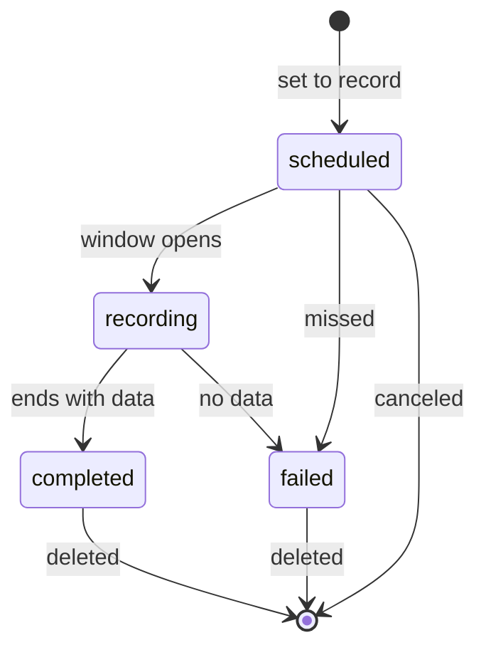

# Recordings

The server records programs from the guide into the [recordings folder](deploy.md#the-recordings-folder) (`SOFA_RECORDINGS_DIR`), as MPEG-TS files named the way Plex, Jellyfin, Emby and Kodi scan them. Manage recordings and series rules in the portal's [DVR](admin.md#dvr) section, in the app (Record in a program's details and the [DVR tab](../../app/docs/usage.md#dvr)), or through the [API](api.md#recordings) with the API token.

## Record a program

`POST /api/v1/recordings` with a channel id and the program's start, as the [guide query](api.md#query-the-guide) gives them, records that one program:

```sh
curl -sS -X POST -H "Authorization: Bearer $SOFA_API_TOKEN" -H 'Content-Type: application/json' \
  -d '{"channelId":"CHANNEL_UUID","startsAt":"2026-10-17T23:00:00Z"}' http://localhost:9193/api/v1/recordings
```

The recording runs from one minute before the program to two minutes after it. Asking again for the same program answers the recording already scheduled.

## Record a time window

Add `endsAt`, and optionally a `title`, to record the channel for exactly that window, whether or not it has a guide:

```sh
curl -sS -X POST -H "Authorization: Bearer $SOFA_API_TOKEN" -H 'Content-Type: application/json' \
  -d '{"channelId":"CHANNEL_UUID","startsAt":"2026-10-17T23:00:00Z","endsAt":"2026-10-18T01:30:00Z","title":"Late Game"}' \
  http://localhost:9193/api/v1/recordings
```

The window runs without padding, spans at most 12 hours and starts at most 14 days ahead, and the server holds at most 100 waiting one-off recordings; without a `title` the recording takes the channel's name. It is named like a show with no episode numbers, under the date it starts. The portal's DVR section has the same form under Record a time window.

## Record a series

A rule records every airing whose title matches, ignoring case, on one channel or on any channel:

```sh
curl -sS -X POST -H "Authorization: Bearer $SOFA_API_TOKEN" -H 'Content-Type: application/json' \
  -d '{"title":"NOVA","newOnly":true}' http://localhost:9193/api/v1/recording-rules
```

| Field | Default | Meaning |
| --- | --- | --- |
| `title` | Required | The program title to match, 1 to 200 characters |
| `channelId` | Any channel | Limit the rule to one channel |
| `newOnly` | `true` | Skip airings the guide marks `previously-shown`, unless it also marks them `new`. A guide that marks neither makes every airing new |
| `keep` | `0`, all | How many finished recordings the rule keeps, newest first |
| `startPaddingSeconds`, `endPaddingSeconds` | `60`, `120` | How far before and after the program the recording runs, 0 to 3600 |
| `priority` | `0` | -100 to 100; the higher wins a playback slot when recordings conflict |
| `match` | By title | `{"kind", "terms", "categories"}`: what the rule matches, below. It never changes once the rule exists |

A rule's `match.kind` is `title`, `team` or `keyword`:

- `title` (or no `match`) matches the title, as above.
- `team` matches any of `terms` as a whole word, ignoring case, in the program's title or episode title, on a program with one of `categories` among its guide categories as a word (`Sports` matches `Sports event`). Without `terms` the team is the rule's `title`, and without `categories` it is `Sports`. `{"title":"Packers","match":{"kind":"team"}}` records `NFL Football` with the episode title `Bears at Packers` on any channel.
- `keyword` matches any of `terms` as a whole word in the title, episode title or description, in one of `categories` when any is given. It needs at least one term.

Each takes up to 20 terms and 20 categories of up to 100 characters. The rule's `title` then only names it in the lists; recordings take their program's title as usual. The rule list answers its `match`; a title rule answers none. The app's program details offer Record for each team a sports program names, and the portal's DVR section adds any of the three.

`PATCH /api/v1/recording-rules/{id}` changes any of these but the title and the match; `"anyChannel":true` clears the channel. The schedule is rebuilt after every guide import, every rule change and every 30 minutes, over the days the guide covers (`SOFA_XMLTV_DAYS`, 3 by default). An airing is skipped when a recording of the same episode is already scheduled, running or kept: the same season and episode numbers, or the same episode title when the guide gives no numbers. An airing with neither, such as a news show, is recorded every time. When the guide moves or drops an airing, its scheduled recording follows. Deleting a scheduled airing of a rule cancels it for good; deleting the rule drops its scheduled recordings and keeps what it recorded.

## While a recording runs

A recording takes one playback slot (`SOFA_MAX_SESSIONS`) for its whole window and shows as `DVR` on the portal's Watching now. It opens the channel the way a player does, so the session picks the channel's healthiest source. An MPEG-TS source shares the upstream connection its players use; an HLS source is stream-copied by FFmpeg. Nothing is transcoded, and the file is written into `.inprogress/` under the recordings folder. When the source drops or goes bad, the recording reopens the channel five seconds later, on the next source when that one is no longer eligible, and appends to the same file. A source that lapses (a playlist that held segments comes back empty with an end marker) ends FFmpeg even while another playlist, such as a separate audio rendition, still advances, and the recorder opens a new session, since a lapse ends the source's own session; a source that starts its numbering over is numbered on for FFmpeg, and FFmpeg that writes nothing for 30 seconds counts as stalled and is reopened the same way. A read that wrote media, stalled or wrote nothing is reopened after a second, and reads that write nothing in a row wait twice as long each time, up to five seconds, since a fresh session of a service such as Pluto often answers with empty playlists. Each read that ends is logged with its byte count, the bytes that read appended, and its reason. At the end the file moves to its place in the layout.

A recording that finds every slot taken retries until its window closes, and a recording can take the slot of a preview or an idle player but never of someone watching. The list marks a scheduled recording as `conflict` when it overlaps more recordings than there are slots: a running recording keeps its slot, a one-off outranks every rule, and then rule priority and the earlier-made recording win. The portal's [Wanted](admin.md#pages) tab lists the conflicts and the recordings that failed in the last 14 days, and puts a conflict's rule first in one step.

A server restart in the middle of a window resumes the recording into the same file. One whose whole window passed while the server was down is marked `failed` with reason `MISSED`.

## Play a recording

A running or finished recording plays through the same [library playback sessions](api.md#play-library-files) as a library file, so the player chooses direct play, a copy into HLS or a conversion by what it can play. A recording still being made always plays as HLS that grows with the file, from its start or wherever the player seeks; it ends a minute after the file stops growing, so when the recording finishes the player reaches the end like any other file. The apps offer Watch from start on a program being recorded, from the live player and the program's details, and Back to live from the recording.

## Commercial breaks

A recording's commercial breaks come from three sources, and Comskip is only an optional one.

1. **Markers.** While the server records an HLS source, it reads the playlists FFmpeg fetches for the same ad markers live sessions read (SCTE-35 cues, stitched-ad hosts and the rest, see [architecture](architecture.md#learned-ad-breaks)) and keeps each marked break as an offset into the file, right to within one segment of each read. FFmpeg reads ahead, so when a read ends (a stall, a lapse or the window's end) the server takes back the segments whose middle lies beyond the bytes written, by their sizes; the rest of the error is the difference between a segment's size fetched and as muxed, under one segment per read. Markers are otherwise exact, so a recording with markers keeps them as its `breaks`. A source that is not HLS has no playlists, and a recording a restart resumed has earlier media the offsets cannot count, so neither gets markers.
2. **Learned ads and slates.** After a recording finishes without markers, the server reads its audio once (FFmpeg at low priority, one recording at a time, streamed so a long file takes little memory) and applies the live rules under `SOFA_LEARNED_BREAKS`: a silent stretch of 20 seconds or more is a slate, and a run of an ad in the break library is a break, once that ad has been heard on two channels or two days and never matched show audio, and only while the library's canary holds. A shorter match of an ad counts when it lies within 5 seconds of one that does. With `on` these are kept as breaks, with `shadow` (the default) each is only logged as `ADDETECT ... recording=true`, and `off` skips the search.
3. **Comskip.** When `SOFA_COMSKIP` names an executable (`comskip` by default, `none` to turn it off), the server runs [Comskip](https://github.com/erikkaashoek/Comskip) on every finished recording too. It finds breaks by black frames, silence, the station logo, scene changes and aspect ratio. It misses some and marks some program as a break, more so on channels without a logo or with short or no black frames between ads. Some distributions no longer package it, and the server runs without it.

The breaks go on the recording as `breaks`, and as a Kodi EDL beside the file (`Show - S01E02 - Title.edl`, action 3, a commercial break), which Kodi and other EDL-aware players skip. Marked breaks are kept as they are; the breaks the other two sources guess are joined where they overlap or lie within 5 seconds of each other, and dropped where they overlap a marked break. The file itself is never cut.

`commercials` says how far it got: `scanning`, `done` (with no `breaks` when nothing found any) or `failed`, which the log explains. It is `failed` only when every source that ran failed, so a recording whose markers or learned breaks were read is `done` when Comskip is missing, and a recording with no source to run is left without `commercials`. A scan a restart interrupts runs again. Deleting a recording deletes its EDL too.

## Cleanup

The DVR deletes finished recordings it no longer keeps, after every recording ends and every 30 minutes, as the Recording cleanup job on the portal's Jobs page:

1. A rule with a `keep` count keeps its newest recordings up to that count; protected ones count toward it.
2. With `SOFA_RECORDINGS_KEEP_DAYS` set, any recording older than that many days.
3. While the recordings folder's disk has less free space than `SOFA_RECORDINGS_FREE_GIB` (10 GiB by default), the next recording in order: watched ones first, then the oldest.

A protected recording is never deleted, nor is a scheduled or running one. Each deletion removes the file and any folders it leaves empty, and logs a `recording culled` line with its reason, `KEEP`, `AGE` or `SPACE`. Both settings are runtime settings on the portal's Settings page.

While a recording runs, the DVR checks the free space every five seconds. Below `SOFA_RECORDINGS_FREE_GIB` it runs the cleanup at once, at most once a minute, so finished recordings make room. Below 512 MiB with nothing left to delete, every running recording stops and keeps what it wrote, with the reason `DISK_FULL`, so the disk never fills.

## States

| `state` | Meaning |
| --- | --- |
| `scheduled` | Waiting for its window to open |
| `recording` | Running now; `path` names the file in `.inprogress/` |
| `completed` | Kept. `path` is where it is in the recordings folder; `reason` says why one was cut short (`STOPPED`, `DISK_FULL`, or the source's last failure) |
| `failed` | Nothing was recorded. `reason` is `MISSED`, `NO_MEDIA`, `DISK_FULL` or why the source could not be read, such as `SOURCE_UNAVAILABLE` or `CAPACITY_EXHAUSTED` |



A program, a time window or a series rule's match schedules a recording. A window that passes without it starting fails it with the reason `MISSED`. While recording, a dropped source reopens the channel and appends to the same file. The recording completes when its window ends or it is stopped, with data in the file, and fails with an empty or missing file. A person or cleanup deletes it. A conflict is a flag on a scheduled recording, not a state.

`DELETE /api/v1/recordings/{id}` cancels a scheduled recording, stops a running one and keeps what it recorded, or deletes a finished one with its file and any folders it leaves empty. `PATCH` sets `protected`, and the `positionMs` and `watched` a player saves.

## Subscribe in a calendar

`/output/recordings.ics` lists the scheduled and running recordings as calendar events, so a calendar app shows when the DVR records. Make a read token on the portal's Settings page, under Access tokens, and subscribe to `http://SERVER_HOST:9193/output/recordings.ics?token=TOKEN` (Google Calendar: Other calendars, From URL; Apple Calendar: File, New Calendar Subscription). The output token works there too. Each event covers the recording's window, paddings included, and a recording in a conflict carries `X-SOFA-KING-CONFLICT:TRUE`. The feed asks to be refreshed every 15 minutes; how often an app does is up to it. The portal's DVR section shows the same schedule, and the recordings done, on its [Calendar](admin.md#pages) tab.

## Limitations

- An HLS source recorded while someone watches the same channel opens a second connection to it; only MPEG-TS sources share one.
- A series rule needs the guide; a channel without one is recorded only as a [time window](#record-a-time-window).
- Cleanup frees space only by deleting finished recordings; when there are none left, a running recording stops rather than fill the disk.
- Breaks are skipped only by the app, with Skip commercials on, and by players that read the EDL.
