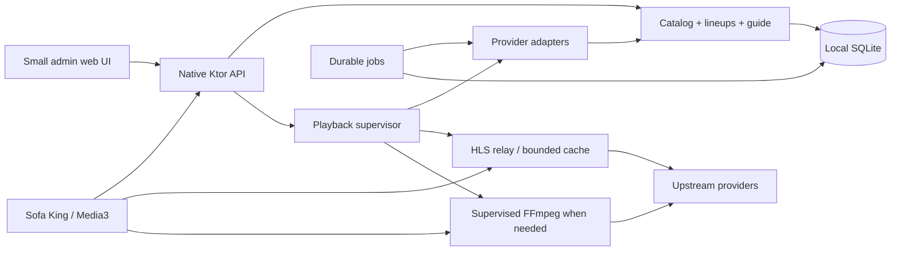

# Sofa King Kotlin IPTV backend — architecture proposal and delivery roadmap

Implementation status: the [working live TV milestone](plans/live-tv.md) and [implementation guide](live-tv.md) distinguish the runnable migration backend from the complete replacement target below.

Date: 2026-10-10. Status: reviewable design proposal; no server or client implementation changes.

## Intent and decisions from James

Replace the household IPTV backend with a streamlined Kotlin server designed for Sofa King. Sofa King is the only target client. Plex Live TV/DVR integration is unnecessary; DVR is a stretch goal. Reliable live viewing, the guide, channel surfing and the existing preview-to-player experience come first.

We own both ends. Neither the API nor the media protocol needs to reproduce Dispatcharr. Design a native contract and select playback formats for performance, reliability and device support. Preserve household channel identities, numbers, favorites and deliberate metadata corrections during migration, rather than preserving old implementation boundaries.

Recommendation: one Kotlin/JVM application, one embedded database, supervised FFmpeg subprocesses where needed, and a phased replacement of existing source services. The durable end state has one IPTV application container; provider bridges are temporary migration dependencies or explicit exceptions.

## What is running and how it is used

Read-only inspection on October 10 confirmed these OMV containers:

| Component | Current role | Replacement destination |
| --- | --- | --- |
| Masqueradarr `:3000` + Mongo 7 | Provider discovery, resolution, guide ingestion, scheduled syncs, exports | Provider adapters, EPG ingestion, durable jobs |
| FastChannels `:5523` | Overlapping FAST discovery/resolution and guides | Initially a bridge adapter, eventually selected native adapters |
| Dispatcharr `:9191` | Channel identities/overrides, source priorities, profiles, EPG joins, MPEG-TS playback proxy | Catalog, lineup policy, guide store and playback supervisor |
| `sofa-king-feeds` `:9192` | Caddy serving custom atomic M3U/XMLTV/metadata exports | Native catalog/guide API |
| Python exporters/probes + cron | Label/logo/guide fixes, duplicate aliases, decoder checks, curated membership | Catalog rules, health service and job runner |
| Plex | Current legacy IPTV consumer/DVR, plus unrelated media library duties | Remove from the IPTV path; unrelated Plex library use is outside scope |

Dispatcharr currently has two ingestion accounts, Masqueradarr and FastChannels, and six guide sources: their guides, mjh Plex US, mjh SamsungTVPlus US, epgshare01 US2 and DaddyLive Gracenote. There are 7,649 stored channel records, many hidden. Do not expose all hidden records merely because they exist.

The published generation at **2026-10-10 15:35 UTC / 10:35 CDT** reports:

| Metric | Curated | Broad |
| --- | ---: | ---: |
| Channels | 916 | 2,081 |
| Genres represented | 16 | 17 |
| Recent video-decode successes | 916 | 927 including duplicate alternatives |
| Failed checks | 0 included | 1,047 |
| Stale/unverified entries | 0 included | 107 |
| Channels with real upcoming guide data | 798 | 1,090 |
| Assigned but empty guides | 89 | 142 |
| Unassigned guides | 29 | 849 |

These are point-in-time startup/video probes, not sustained viewing or Android decoder certification. Yesterday's curated count was 942; today's 916 illustrates why health must be a first-class concern. A rewrite cannot manufacture reliable upstream streams.

Current client code uses two HTTP downloads, an XMLTV parser, numeric guide IDs and MPEG-TS URLs. Favorites and recent channels are keyed to guide IDs derived from channel numbers. It has one Media3 player shared by muted guide preview and full-screen playback; preview tunes after 350 ms of stable focus, and backgrounding stops playback. Preserve that interaction, while improving session cancellation and identity.

The five IPTV containers consumed approximately **3.3 GiB combined** in one idle-ish sample. This is an opportunity for consolidation, not a forecast of Kotlin memory savings. OMV currently exposes 10 vCPUs and about 29 GiB RAM in a virtualized environment; the new server can start there without a hardware purchase.

“Plex” in upstream provider metadata also means the Plex FAST channel service. Removing the Plex media server from IPTV does not require dropping those FAST channels.

Evidence: live Docker/Django/HTTP inspection, private household feed-contract/playback/audit records, and Sofa King's [Android architecture](https://github.com/jamesarich/sofa-king/blob/main/docs/ARCHITECTURE.md) and data/player code. Household records remain outside Git because they contain operational details.

## Alternatives

| Approach | Benefit | Cost | Decision |
| --- | --- | --- | --- |
| Kotlin facade over the existing stack | Fastest native client API | Keeps duplicate state, proxy chains and operational burden | Useful only as a migration stage |
| Staged Kotlin replacement | Each removed layer has demonstrated parity; household viewing can continue | Temporary adapters and an explicit migration period | Recommended |
| Rewrite every source and media path immediately | Clean end-state sooner on paper | Largest risk is provider-specific behavior, not REST endpoints; difficult rollback | Reject as the starting strategy |

No microservices, Redis, Kafka, external search server, HDHomeRun emulator or Xtream output in the initial design. They do not serve the stated household workflow.

## Target topology

All boxes except providers and the TV are logical components of one deployed application. FFmpeg is a subprocess managed by that application, not another independently configured service. During migration, some provider adapters call Masqueradarr/FastChannels; those bridges are retired per provider.

### Technology choices

- Kotlin/JVM with a supported LTS JDK; Ktor server and client, kotlinx.coroutines and kotlinx.serialization. Pin concrete versions when implementation starts.
- Ktor Netty initially, with explicit limits for long-lived connections and streaming work. Coroutine cancellation does not by itself guarantee an upstream socket or FFmpeg child has stopped; ownership and timeouts must be explicit.
- SQLite in WAL mode on a local filesystem; Exposed JDBC DSL and versioned SQL migrations. Use a bounded database dispatcher and short serialized write transactions; never perform network or media work inside a transaction.
- Stream XMLTV parsing with DTD/external entities disabled, bounded decompression and per-source limits. Keep the application JVM-only; the Android/JVM client can share a small pure Kotlin API-contract module without introducing KMP server targets.
- FFmpeg/ffprobe for probing, remux and exceptional transcode paths. Stream copy where possible. No custom Kotlin codecs or GPU dependency for the base service.
- Small Ktor-served admin pages with forms and an event stream. Do not begin with another large SPA or a Compose web experiment.

SQLite matches the single-host, small-household control workload. Media bytes live in memory/files, not database BLOBs. Revisit PostgreSQL only if measured write contention or multiple active server instances justify it. SQLite WAL requires same-host access and supports one writer at a time; place the DB on local VM storage, not an SMB/NFS mount. [SQLite WAL](https://sqlite.org/wal.html), [Exposed database support](https://www.jetbrains.com/help/exposed/working-with-database.html).

Ktor supports incremental binary responses and file/range responses. Those are transport primitives, not a ready-made IPTV session manager. [Ktor responses](https://ktor.io/docs/server-responses.html).

## Component boundaries

| Component | Owns | Depends on |
| --- | --- | --- |
| Catalog | Canonical channels, source offerings, aliases, edits, numbering, profile rules | Store, normalized adapter results |
| Guide | Guide sources, station mappings, real programmes, provenance, time-window queries | Store, EPG ingesters |
| Providers | Discover, fetch guide, resolve playback, renew auth, source capabilities | Restricted HTTP clients and secret store |
| Playback | Sessions, upstream capacity, transport choice, recovery, worker lifetime | Providers, media workers, device capabilities |
| Health | Source/offer observations, decode/device evidence, expiry and publication policy | Playback/probes, store |
| Jobs | Persisted schedule, leases, retry budget, recovery after restart | Store; invokes bounded component operations |
| HTTP/admin | Versioned DTOs, pairing, query validation, management views | Component interfaces |

Use these as packages initially; split Gradle modules only for `api-contract`, the server, and materially useful isolation. Adapter implementations must not write catalog tables directly or reach into playback internals.

## Catalog and persistence model

Distinguish the channel a person watches from an offering supplied by a provider.

| Entity | Key and important fields |
| --- | --- |
| Channel | Owned UUID; display number as a decimal string; name, genre, country, languages, flags, explicit edits |
| Offering | `(provider instance, provider channel key)`; canonical UUID, feed variant, region, source metadata, capabilities, resolver reference |
| ChannelAlias | Old UUID to canonical UUID, reason and review evidence |
| ChannelOverride | Field edits separate from refreshed source facts; source/reason for mapping |
| Lineup | Selection rules and pinned membership; order; curated or diagnostic purpose |
| GuideStation / Mapping | Source station key; channel/feed relation; region/time zone; manual or evidenced match |
| Programme | Station, source programme key or deterministic fingerprint, start/end UTC, details and provenance |
| HealthObservation | Offering, path/device class, observed/expiry times, transport/decode result and sanitized reason |
| Job | Type, scope, scheduled time, state, lease, attempt, idempotency key |
| Device / Session | Paired client, capability class, playback intent, lease, current stream epoch |
| ProviderSecret | Secret reference, encrypted credential/session material and refresh state |

Import existing UUIDs and display numbers. New channels get IDs owned by this backend. A vanished source offering becomes inactive; it does not delete the channel or reset favorites. Return aliases to the client when genuinely equivalent channels are consolidated. Do not reuse old numbers silently.

Channel matching must consider station, feed, country, region, time zone and linear-versus-FAST identity. Similar names are review candidates, not merge proof. Carry forward corrections already made for NFL Channel/NFL Network and the Spanish channels. Unknown language/region remains unknown.

Keep source observations pristine and user edits separate so refresh cannot overwrite the household's organization. An upstream empty/malformed result must not erase the catalog: distinguish a valid complete empty result from partial fetch failure, retain the last good snapshot, mark freshness, and review abnormal shrinkage.

### Guide handling

Preserve the existing guide assignments, especially the 66 DaddyLive US station mappings and Des Moines/50325 regional context. Provider schedules are the first choice for their own FAST feeds; regional Gracenote and existing XMLTV sources fill appropriate gaps. Never assign a west-coast schedule to an east-coast feed based on its name alone.

Publish `available`, `empty`, `unassigned`, or `stale` with provenance and coverage times. No generated fake programme listings. A channel without guide data remains watchable. Store real timestamps in UTC, retain source time zone, and define queries as overlapping a half-open `[from,to)` interval. Reject invalid intervals/control characters safely, count discarded records and surface source quality.

Ingest into a staging revision, validate, then activate in one short transaction. Catalog membership and guide source updates have separate revisions; unrelated guide refreshes do not invalidate every channel cache.

## Native Sofa King API

The primary API is compact JSON with independent catalog, guide and health revisions. Shared Kotlin serializable DTOs and a small client library provide typed queries, cancellation and structured errors. Share the wire contract, not database entities or Android UI models. Produce an OpenAPI description for inspection and contract validation.

| Endpoint | Purpose |
| --- | --- |
| `GET /api/v1/bootstrap` | Server identity, capabilities, lineups, API version, current revisions, server time |
| `GET /api/v1/lineups/{id}/channels` | Ordered compact channel snapshot, aliases and ETag |
| `GET /api/v1/lineups/{id}/now-next` | Current/next programmes plus freshness; useful before loading a grid |
| `POST /api/v1/guide/query` | Bounded channel-ID set and time window; only the requested grid data |
| `GET /api/v1/events?after={cursor}` | SSE invalidation and session-state events with replay cursor |
| `POST /api/v1/playback-sessions` | Channel UUID, preview/watch intent, client capabilities and idempotency key |
| `GET /api/v1/playback-sessions/{id}` | Opening/ready/recovering/failed state and current playback descriptor |
| `PATCH /api/v1/playback-sessions/{id}` | Renew lease or promote preview to watching |
| `DELETE /api/v1/playback-sessions/{id}` | Release the subscriber and stop idle upstream work |
| `/media/sessions/{id}/{epoch}/…` | Scoped playlist, segment, subtitle and stream resources |

An opening session returns `202` with its state URL; a ready one can return `201` with a descriptor. SSE reports readiness; polling is the fallback. Creation and cancellation are idempotent. No HTTP request is held indefinitely while a source resolves.

A channel DTO exposes `id`, `displayNumber`, display metadata, tags, guide availability and playback eligibility. It does not contain a provider's signed URL or credential. A playback descriptor exposes protocol, MIME type, server URL, stream epoch, expiry and optional seekable range. Errors have a stable code, retryability and suggested retry delay; examples include `SOURCE_UNAVAILABLE`, `CAPACITY_EXHAUSTED`, `DEVICE_UNSUPPORTED`, `AUTH_REQUIRED` and `SESSION_EXPIRED`.

Use ETags and compression for control responses. One catalog download for the household's roughly 2,000 visible channels is reasonable; avoid a paginated waterfall for channel surfing. Guide requests are capped at 200 channel IDs and 24 hours per request initially; fetch the visible rows plus a look-ahead window and cache by revision. Do not send the whole national guide or poll it each minute. The app's local clock advances programme progress.

Each guide response includes its revision, requested coverage interval, per-channel coverage and programmes keyed by channel UUID. Clients can pin a revision while fetching adjacent grid batches; the server either serves that retained snapshot or returns `RESYNC_REQUIRED`, rather than mixing revisions silently. Expose opaque programme IDs for selection and a future recording request. Keep control-plane times as explicit UTC instants and display numbers as strings, independent of UUIDs.

The client library should offer `observeLineup`, `guideWindow`, `openPlayback`, `promoteToWatching` and `close`, with sealed session states and typed errors. `openPlayback` returns a cancellable handle rather than requiring the UI to juggle raw URLs, polling and SSE itself. Cancellation after creation still sends release; a response arriving after local cancellation is released immediately. Transport recovery remains owned by the library/session layer, with the UI observing state. Native payload size and client allocation must be measured before adding a binary encoding; JSON plus bounded queries is the initial choice.

SSE events invalidate resources or describe session transitions; do not broadcast the whole guide. Maintain a bounded replay log. An expired cursor returns `RESYNC_REQUIRED`; the client refetches snapshots. If events disconnect, playback continues and conditional refresh/polling provides correctness.

On reconnection after prolonged inactivity, compare revisions, reconcile aliases, and refresh only affected guide windows. Preserve last good client snapshots with explicit freshness, including offline guide behavior.

### Client changes

Replace `DispatcharrRepository` with a native repository/client. Bootstrap and cached channels render first, now/next follows, then guide windows load as needed. Migrate favorites, last channel and per-channel caption settings from legacy guide IDs to UUIDs using the imported legacy mapping. Keep migration idempotent and retain old keys until successful.

The one Media3 player remains. Stable preview focus opens a low-priority session; moving focus cancels the prior operation and releases its session. A tune sequence token prevents a late A response from replacing newer channel B. OK promotes the existing preview session and uses the same media item; Back changes intent without a fresh upstream tune. Stop/background explicitly releases the session; expiry is the crash recovery fallback.

Report actual device codec/transport capabilities. On a new stream epoch after failover, the client reopens the descriptor and renderer as required. This is a deliberate recovery contract, not an attempt to hide incompatible streams in one endless connection.

M3U/XMLTV exports may be added for debugging or outside clients, but neither legacy Dispatcharr paths nor an unchanged client build is a milestone requirement.

## Playback design

### Choose delivery per source and device

1. **Default: relay native upstream HLS.** Resolve at play time. Rewrite master/media playlists to scoped server URLs; preserve renditions, alternate audio, subtitles, keys and timing. Fetch shared eligible segments on demand into a bounded cache. Keep provider headers/tokens at the server.
2. **Non-HLS or incompatible packaging: supervised FFmpeg stream-copy/remux.** Generate HLS when practical. MPEG-TS delivery remains an available measured option for a source/device combination if it materially improves live startup; there is no requirement to use it universally.
3. **Unsupported codecs: an explicit bounded transcode profile.** Prefer a compatible rendition/source first. Admit a transcode only if capacity allows. Test audio and captions as well as video.
4. **Direct upstream playback: exceptional opt-in.** Only for a provider that needs no secret headers, supports it, and shows a meaningful latency gain. The default keeps upstream details and health observation on the server.

Media3 supports HLS with MPEG-TS and fMP4, including CEA-608/708 and WebVTT, but the device still must support the contained codecs. Native HLS avoids routinely throwing away upstream adaptation. [Media3 format support](https://developer.android.com/media/media3/exoplayer/supported-formats). FFmpeg supports stream copy and remuxing; validate preserved tracks rather than assuming an all-stream mapping is correct for every output. [FFmpeg](https://ffmpeg.org/ffmpeg.html).

No promise that HLS is fastest for every source. Upstream segment/GOP lengths constrain startup; remuxing cannot invent frequent keyframes without encoding. Low-latency HLS is not enabled globally merely because Media3 supports it. Benchmark native HLS relay, remuxed HLS and TS using the Chromecast and representative providers; keep the best supported policy per source/device class.

### Sessions and shared upstream work

Client sessions are separate from upstream workers. A worker is keyed by offering, authorization/session scope and delivery profile. Reuse a worker/cache only when the adapter declares sharing safe; different personalized ad sessions or accounts must not be combined accidentally.

Admission checks per-provider stream limits and a global worker/transcode budget. Preview work has lower priority than watching. Probes yield to viewers and cannot consume every upstream slot. Shared remux workers require a bounded subscriber buffer and valid join/bootstrap behavior; slow readers are disconnected without blocking everybody else.

Start with a 30-second client renewal and a 90-second session lease; allow a short 5-second idle grace after the last subscriber to reduce channel-surf churn. Media requests can also refresh activity, but cannot silently turn a released session back on. Release is exact-once in effect. Disconnected/crashed clients do not leave immortal streams.

Provider resolution has a deadline, concurrency limit, expiry-aware cache and single-flight protection. FFmpeg stdin/stdout/stderr and process groups have one owner; continuously drain stderr, bound logs, monitor progress, and terminate/reap children on stop, timeout, failure or shutdown. Enforce connect/read/progress deadlines independently.

Relay correctness includes relative URLs, variant playlists, audio/subtitle paths, AES-128 key resources, byte ranges, redirects, initialization maps, discontinuities, rotating tokens and live playlist progression. Check authorized upstream hosts on each redirect and URI resolution. Avoid caching personalized/key material across scopes. A URL returning bytes is not evidence that its live timeline is advancing.

### Recovery

Track no-progress stalls independently from an open connection. Retry transient fetches with bounded jitter, re-resolve expired credentials once, then try a verified equivalent offering. Provider circuit breakers suppress resolution storms and use bounded half-open checks.

When switching offerings, issue a new stream epoch and a `playback.descriptorChanged` event. The client handles the decoder/timeline transition explicitly. Attempt a fresh descriptor rather than concatenating TS streams or independent HLS sequence numbers. Mark interrupted sessions recovering, then ready or failed with a clear bounded timeout.

Do not substitute a similarly named FAST channel for the requested linear network. If no equivalent source is available, report unavailable honestly.

## Health, jobs and operations

Health has multiple dimensions: catalog freshness, resolver success, media delivery/progression, decode evidence, audio presence and device compatibility. Preserve observation times and durations. FFmpeg video startup success must never be labeled complete Chromecast verification.

Initially retain the existing curated policy of a video-decode check younger than 36 hours. For native playback the evidence must cover the new delivery path; imported Dispatcharr results are historical evidence only. Keep curated eligibility separate from lineup pins and transient availability so favorites survive outages. Diagnostic inventory retains failures with reasons. Eligibility changes can refresh the guide at a quiet point rather than yanking a currently playing row out of the UI.

Prioritize watched/pinned channels and newly changed offerings; rotate the remaining catalog within the freshness window. Use a provider-level circuit breaker and small representative checks before probing hundreds of channels during an outage. Probes may attach to a compatible active worker to avoid opening another provider connection. Startup decode evidence expires; actual client playback observations supplement it without silently claiming certification.

### Automatic source culling and recovery

James requested automatic culling of bad channel sources. Make this an offering-level lifecycle owned by the health service. Quarantined offerings are excluded from normal playback selection; archived offerings leave the active source inventory. Preserve their identifiers and evidence so rediscovery cannot silently undo a cull. Channel UUIDs, favorites, number assignments and guide mappings survive losing an offering.

Use `unverified → healthy → suspect → quarantined → probation → healthy`, with `archived` for sustained dead or reliably withdrawn offerings. An independent manual-disable flag always wins over automatic recovery. Persist transitions, reasons, counters, next-check times and policy version. An incident ID deduplicates failures from retries, multiple subscribers on one worker, and a probe sharing that worker.

Proposed initial policy, to tune against household observations:

| Evidence | Automatic action |
| --- | --- |
| A playback startup fails or the media timeline stalls beyond its delivery deadline | Mark the offering suspect and skip it for the current incident; try a verified equivalent alternative |
| Three independent qualified failures within six hours, spanning at least ten minutes, with no intervening successful qualification | Quarantine the offering and remove it from normal source selection |
| Quarantine recovery is due | Run one low-priority qualification after 15 minutes, then back off to one hour, six hours and daily on continued failure; add jitter |
| A quarantined offering passes a 30-second media-progression/video-decode check with required audio present | Enter probation; allow only bounded recovery checks initially |
| A second qualification succeeds at least ten minutes later | Restore eligibility subject to freshness/device requirements; retain failure history so it does not immediately regain top priority |
| An offering is absent from at least two successful complete provider snapshots spanning seven days | Archive as withdrawn; partial/failed imports never count as absence |
| An offering has no successful qualification for fourteen days and fails recovery checks on at least three distinct days | Archive as persistently dead; retain a low-frequency weekly recovery check |

Qualification intervals are lower bounds, not a reason to interrupt a healthy viewer or exceed provider limits. A successful qualified viewing interval can count as recovery evidence when the worker/device observations meet the same requirements. Unknown/audio-only channels require explicit channel-type policy; a missing audio track is not a universal failure rule. Temporary expired URLs must be freshly resolved before classifying persistent failure.

Separate failure domains before counting strikes. HTTP 429/capacity exhaustion triggers cooldown; expired credentials trigger auth renewal or provider-level `AUTH_REQUIRED`; a single device's unsupported codec changes that device class's eligibility. Server resource exhaustion or household network failure cannot condemn every upstream offering. Genuine wrong-feed/decoy reports get a distinct blocked reason and manual review; successful decoding alone cannot establish station identity.

Correlated failures across offerings open the provider circuit and suppress per-offering strike escalation. Initially use failures on three distinct offerings within five minutes as a trigger for provider diagnosis, not proof by itself; distinguish provider outage, auth failure, rate limiting and local failure before escalation. A half-open representative check restores provider access gradually. Keep previously healthy offerings' evidence and identities, but expose the provider's current unavailability; fresh eligibility still needs a valid observation. Do not mark a shared outage as thousands of permanently bad sources.

Select sources by eligibility, device support and explicit household priority, then sustained reliability and startup behavior. Use minimum sample counts and hysteresis before changing automatic order; a single quick success cannot outrank a long-established reliable offering. A catalog re-sync cannot reset quarantine or manual disables. Changed resolver inputs can schedule fresh qualification, but do not immediately mark the offering healthy.

If a channel loses all eligible offerings, hide it from ordinary curated browsing after policy evaluation. Keep favorites visible as unavailable with a recovery action, and retain the channel in diagnostic inventory. Do not stop an otherwise progressing active stream merely because a background probe failed. On recovery, restore the same channel identity and notify Sofa King through health/lineup revisions.

Admin controls: inspect why/when a source was culled, restore to probation, request a qualification, disable manually and adjust source-specific policy. Export sanitized transition history. Automatic archival is reversible; permanent deletion is a separate explicit cleanup operation. This is a v1 live-reliability requirement, not part of the DVR stretch goal.

Durable jobs include provider sync, guide import, health check, auth renewal, artwork cleanup and backup. Persist due times and leases. Execute at least once, with idempotent snapshot activation keyed by job scope/revision. Reclaim expired leases after restart, coalesce missed recurring syncs, and prevent overlapping runs per source. Schedules use `America/Chicago` where household-local timing matters; timestamps remain UTC. Coroutine scopes run work but are not the durable queue.

Admin pages need: sources/auth state, sync health, channel edits, duplicate/mapping review, guide coverage, failed channels, active sessions, stop/retry actions and backup/restore. Keep provider internals out of the TV's normal viewing flow.

Structured logs, request/session correlation, decoder/relay reasons, stream counts, orphan workers, source failure rates and startup percentiles are enough initially. No mandatory monitoring stack. Pin deployed images and dependency versions rather than using floating `latest` tags.

### Access and deployment

Pair the TV using a short-lived code confirmed in the local admin UI. Store a revocable device credential with lineup permissions. Admin sessions are separate. Scope media authorization to a playback session; use headers where the player supports them, otherwise short-lived resource tokens with query redaction in logs. Renewal must keep long viewing sessions alive without reopening playback every few minutes.

Default to LAN binding; use the existing reverse proxy/TLS where available. Provider-secret encryption uses an external mounted key, not a key stored beside its ciphertext in SQLite. Redact signed URLs, cookies and headers; import credentials through secret references rather than the plan or source control. Allow only configured LAN bridge destinations during migration and provider-controlled destinations for ordinary adapters.

One container with `/data` for DB/config/artwork and bounded ephemeral cache, plus FFmpeg in its image. Cap cache bytes and processes. Benchmark with four concurrent household streams initially; this is a test target, not a discovered household requirement. Keep an escape hatch to increase admission limits after measurement.

Use SQLite's supported online backup mechanism or a coordinated snapshot including WAL; copying the active `.db` file alone is insufficient. Back up secrets/key material separately and prove restore to a spare instance. A server restart should preserve catalog/guide and jobs, expire obsolete sessions, and reconnect clients cleanly.

## Provider strategy

Provider adapters expose `discover`, `fetchGuide`, `resolve`, `renewAuth`, and declared capabilities such as sharing rules, stream limits and media formats. Resolve returns expiring media metadata and secret-header references, not a permanent URL baked into a catalog.

Start with two bridge adapters for the existing Masqueradarr and FastChannels services. Import the true offering/source relationships, priorities and guide mappings, not only their flattened M3U. Read/export native state once through isolated migration tools; the production server must not depend on undocumented Django models.

Prioritize native ports by household value, verified coverage, reliability and maintenance effort. Current curated metadata has substantial Samsung, Roku, Xumo, Plex FAST, LG/TCL/Vizio and Whale coverage, but counts overlap because channels can have multiple offerings. Do not interpret those counts as independent unique-channel contributions. Record actual watched-channel usage before deciding port order.

Port one simple dependable FAST adapter first, then the useful long tail. DaddyLive is a separate integration because resolution and event feeds differ from stable FAST services. Preserve the existing Gracenote guide mappings independently of its resolver. Treat local affiliates and regional feeds as distinct identities.

Provider-specific scraping and session renewal are the main ongoing maintenance cost. A Kotlin rewrite cannot remove it. The current Masqueradarr already has pluggable adapters and resolve-on-demand playback; borrow behavior and fixture knowledge where licensing permits, rather than assuming those concepts are new. [Masqueradarr upstream](https://github.com/TheBinaryNinja/masqueradarr).

Authenticated/DRM browser-bridge services and experimental zlive resolution are outside the first release. Their current existence does not establish drop-in streams. FastChannels documents both ordinary feeds and separate browser/DRM bridge paths; retain only integrations actually needed and proven. [FastChannels upstream](https://github.com/kineticman/FastChannels). The application does not invent a DRM-removal layer.

Before incorporating upstream code, record licenses and isolate incompatible dependencies. A source adapter can be implemented against its documented behavior without copying the whole application. Keep optional external bridges if a native port would add more operational complexity than it removes.

## Delivery roadmap and exit gates

This is an architectural roadmap. Detailed file-by-file implementation tasks follow review of this proposal; this work only produces the design artifact.

### 0. Baseline and playback feasibility

Inventory watched/pinned channels, existing source configuration, guide mappings, aliases, health evidence, numbers and secrets references. Capture reproducible sanitized fixtures and current Chromecast timings. Prototype native HLS relay and a supervised remux path against a representative sample: FAST, DaddyLive, local, alternate audio, captions, discontinuities and token expiry.

Exit: choose transport policy from device evidence, identify all required source exceptions, and document channel-start/caption behavior. Suggested acceptance targets are p95 warm tune to first frame at most 3 seconds and cold tune at most 6 seconds for stable sources; exceptions are measured and identified. These are targets, not current measured guarantees. Verify aborting a preview actually releases work.

### 1. Native catalog and guide vertical slice

Stand up the Ktor/SQLite service alongside production on a verified-free LAN port. Import UUIDs, numbers, overrides, source relations and guide mappings. Bridge existing upstream services. Implement bootstrap, channel snapshot, now/next and guide query with revisions. Add the native repository and UUID settings migration to Sofa King, with a backend setting for rollback. Playback may still use an explicitly identified Dispatcharr bridge during this short stage.

Exit: channels/mappings/aliases reconcile against imported inventory, no silent renumbering or false merges, favorites migrate, actual guide gaps remain explicit, and the Chromecast renders cached channels and guide windows correctly. The TV no longer relies on M3U/XMLTV as its primary contract.

### 2. Own live sessions and retire Dispatcharr

Implement session creation, cancellation, promotion, leases, source capacity, native relay, remux supervision and recovery. Include offering quarantine/probation, correlated-outage handling and persisted recovery jobs. Switch Sofa King to owned session descriptors. Reverify curated channels through the new delivery path. The source bridges now resolve directly through Masqueradarr/FastChannels rather than chaining through Dispatcharr.

Exit: sustained household playback and failure recovery work, two viewers can share where safe, four-stream budget test passes, captions/audio survive, stale/slow sessions cannot leak workers, and cross-scope streams are never shared. Cut over only after at least seven days of representative household use with a retained rollback path. Retire Dispatcharr and the feed Caddy container after acceptance.

### 3. Replace custom maintenance and converge the sources

Move health checks, guide jobs, catalog rules and admin edits fully into the server. Disable corresponding old cron/export jobs so there is one writer for each responsibility. Port high-value providers individually with old/new fixtures and device checks. Stop Masqueradarr/Mongo or FastChannels only when their last required offering and guide dependency has moved.

Exit: one authoritative catalog, no script-dependent publication, backup/restore demonstrated, and every remaining bridge is named with a reason. The achievable steady state is one Kotlin container; do not force removal of a useful specialized bridge just to meet a container count.

### 4. Stretch: server timeshift and DVR

Only after live acceptance, add bounded persistent segment storage, a seekable-range API, session pinning and recordings. Relay cache alone is not a DVR: live-window manifests, segment retention, timestamps, encryption/key policy, discontinuities and audio/subtitles need deliberate persistence. Start with pause/rewind for active clear streams, then one-off programme recordings; recurring series rules follow separately.

DVR jobs need recording admission priority, schedule padding, restart recovery, partial-file finalization, quota/retention and recorded-media playback. Reuse playback workers when the offering supports sharing. At 8 Mbit/s, one stream uses roughly 3.6 GB/hour; 30 minutes of buffer is about 1.8 GB. Recording multiple channels scales by bitrate and duration, so set a storage budget explicitly. No always-on recording of the whole catalog.

## Validation and rollback

Tests should cover behavior that caused today's maintenance burden: source edits surviving sync, exact/ambiguous station matching, false FAST/linear merges, guide provenance and time-zone intervals, partial/empty imports, aliases and client settings migration.

Use a controllable fake upstream for live playback: expiring URLs, stalled-but-open streams, failing segments, redirects, byte ranges, captions, manifest discontinuities, auth renewal, late tune responses, duplicate starts and client disconnects. Soak zap/preview cycles and verify active-worker counts return to baseline. Compare direct provider success, server delivery success and Android playback separately.

Exercise automatic culling with an injected clock: distinct incidents cross the quarantine threshold, shared-worker errors count once, retry success clears a consecutive-failure streak, recovery obeys probation intervals, provider outages do not create mass strikes, and partial discovery does not archive sources. Verify resync/restart preserves quarantine and manual disables, recovered offerings restore the original channel, favorites remain discoverable, and archival retains recovery/audit records.

Benchmark actual Chromecast cache load, grid scrolling, time to first frame, audio/video, captions and preview promotion. Targets: cached usable lineup under 0.5 seconds; native guide consumption no worse than the existing build; no new upstream request or player reset on preview promotion; source recovery within a bounded visible interval; zero orphan workers after the idle/lease window. Media benchmarks under concurrent viewing/probing matter more than synthetic REST throughput.

Migration is additive. Keep an untouched production backend snapshot and a separately packaged client rollback build. Copy/import into the new DB; never run two periodic writers against Dispatcharr state. Maintain a cutover manifest naming each disabled cron/service and its saved configuration. Restore the client's backend choice/build and re-enable the prior services/jobs to roll back; do not replay old source snapshots over later user edits. Preserve old volumes until an accepted stable period and restore exercise.

## Review questions and assumptions

The scope choices are settled: Sofa King only, native API/transport freedom, live TV first, DVR stretch. The remaining implementation assumptions are one household/one server, initially four concurrent streams, local DB storage, and no required authenticated browser/DRM source in v1. Confirm actual watched channels and concurrency from observation before setting provider priorities and limits.

The hardest feasibility gate is sustained, cancellable, caption-correct playback through the native delivery path. The first useful release should make Sofa King's catalog/guide consumption better while retaining working sources, then prove that the media path is good enough to remove Dispatcharr. A prettier REST API alone is not the replacement.
